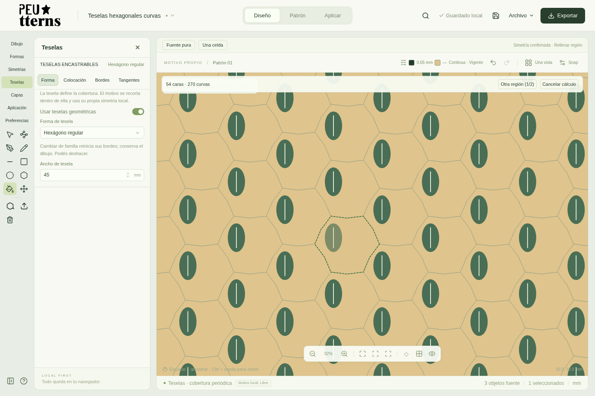

# Pattern Studio 2D

Estudio vectorial para dibujar motivos, explorar simetrías y construir patrones y teselas editables. El dibujo se repite mientras trabajás: las copias comparten una fuente canónica, de modo que editar una actualiza el patrón completo.

Funciona en el navegador, procesa toda la geometría localmente y se puede desplegar como archivos estáticos. No requiere cuentas, APIs ni conexión a servicios externos.


## Qué podés crear

- Motivos a mano alzada, líneas, curvas Bézier y formas cerradas, con medidas físicas en milímetros.
- Patrones con los 17 grupos del plano, siete frisos y simetrías radiales. Las miniaturas usan tu dibujo para mostrar qué hace cada opción.
- Trazos continuos, punteados o personalizados; perfiles de ancho variable, colores, opacidades, paletas y estilos guardados.
- Rellenos vectoriales de objetos cerrados o de regiones delimitadas por varios trazos, incluso desde copias reflejadas o rotadas.
- Teselas encastrables con bordes curvos y patrones aplicados sobre perímetros con agujeros.
- Archivos JSON editables y exportaciones SVG, PNG, JPEG y DXF.

## Primeros pasos

1. Empezá en **Libre** y dibujá un motivo. Usá línea, pluma, lápiz, rectángulo, elipse o polígono.
2. Abrí el indicador de estilo para elegir trazo, grosor y relleno en el panel derecho. **Vigente · nuevos objetos** controla lo que vas a dibujar; **Selección** modifica los objetos seleccionados. La opción visible de actualizar el estilo vigente define cómo se relacionan ambos.
3. Abrí **Simetrías → Grupo y red** en la barra izquierda. Pasá por las miniaturas de **Simetría viva** para explorar. Clic, Enter o Espacio confirman el grupo y conservan tus fuentes. Podés seguir dibujando desde cualquier copia.
4. Elegí **Rellenar región** y hacé clic dentro de una zona cerrada. El color queda aplicado al retirar el puntero; en una pantalla táctil alcanza un toque. Deshacer revierte la operación. No hace falta un botón de confirmación.
5. Guardá el proyecto en JSON para continuar editándolo o usá **Exportar** para obtener el resultado final.

La pluma termina con Enter, se cierra con Shift+Enter o un clic sobre el primer nodo y se cancela con Esc. Espacio permite arrastrar la vista; Ctrl + rueda controla el zoom.

La navegación v2.3 está en desarrollo: la barra izquierda separa **Dibujo,
Formas, Simetrías, Teselas, Capas, Aplicación y Preferencias**. En **Formas**,
**Polígono paramétrico · crear** muestra los parámetros editables. El panel
derecho conserva colores y trazos. Las capturas siguientes corresponden a
v2.2; los proyectos descargables siguen siendo compatibles.

## Ejemplos de uso

### Explorar un motivo sin perder el dibujo original

En **Archivo → Ejemplos editables**, abrí **Hexagonal · p6m** para obtener la escena de la primera imagen. Pasá por p1, p4m y p6m y confirmá una opción. Las miniaturas se actualizan con tu motivo; la selección, la herramienta y las fuentes siguen disponibles. [Descargar este proyecto de ejemplo](docs/examples/studio-symmetry.json).

Diseño y Patrón son vistas de énfasis del mismo documento. **Fuente pura**, **Una celda** y la vista dividida ayudan a entender cómo se construye la repetición. Los conjuntos pueden heredar la simetría principal, tener una propia o permanecer libres.

### Pintar una región formada por varias curvas

Dibujá cuatro segmentos o curvas que delimiten un área y elegí un color de relleno. Con **Rellenar región**, pulsá su interior: se crea un contorno vectorial editable y se conservan los trazos originales. La imagen muestra cuatro curvas independientes y un círculo interior: el hueco permanece vacío y el relleno se propaga por la repetición.


[Descargar el proyecto de las cuatro curvas](docs/examples/vector-fill.json) y abrirlo desde **Archivo** para inspeccionar las fuentes y el relleno.

El relleno puede quedar **vinculado** a sus límites o **fijo**. Si cambia una topología y el vínculo deja de ser válido, se conserva el último contorno y se muestra su estado; **Recalcular y vincular región** intenta recuperar una cara equivalente. Volver a pulsar una zona pintada permite recolorearla sin crear copias idénticas.

Por defecto se exige cierre geométrico dentro del epsilon numérico. Para pequeños huecos, aumentá explícitamente **Tolerancia de cierre de Fill** en el panel derecho; esta opción no modifica los trazos originales. Las guías y los espejos de estructura no cuentan como límites materiales.

### Construir teselas con bordes curvos

Abrí **Teselas encastrables**, elegí una forma y activá **Editar bordes de tesela**. Al mover nodos y tangentes, los bordes correspondientes cambian juntos para conservar el encastre. Pintá el interior con Fill y seguí dibujando sobre las copias.



[Descargar el proyecto de teselas curvas](docs/examples/curved-tiles.json) para explorar sus bordes y su fondo por separado.

Hay cuadrados, rectángulos, paralelogramos, triángulos equiláteros y hexágonos regulares. Los vértices estructurales permanecen fijos y las curvas se limitan a corredores seguros. En triángulos se edita media curva y se deriva su pareja mediante simetría central. No se ofrecen polígonos arbitrarios como si pudieran teselar.

El dibujo interior y el contorno de tesela son entidades diferentes. Ajustar al patrón encuadra la tesela de referencia. Para incluir el contorno en SVG, DXF o raster, activá **Exportar contornos de teselas**. Las aristas compartidas se deduplican. El generador legado **Motivos escalonados** y la región aperiódica finita de Penrose siguen disponibles por separado.

### Ajustar apariencia, guardar estilos y componer

El panel derecho ofrece colores HEX, alfa, grosores, extremos, uniones, secuencias discontinuas y un editor visual de perfiles de ancho. Guardá un estilo con nombre para reutilizar sus valores sin modificar retroactivamente los objetos anteriores. El indicador compacto sigue visible al cerrar el panel; podés fijarlo abierto o dejar que se autocierre al volver al lienzo.

**Capas** permite nombrar, ocultar, bloquear y ordenar objetos. En **Aplicar**, creá o importá un perímetro cerrado y colocá el conjunto sobre él. Una aplicación congelada conserva su simetría efectiva aunque cambie la principal. El exportador permite elegir el conjunto activo o la composición visible; sólo ofrece una celda común cuando su periodicidad está verificada.

## Guardado y privacidad

El autosave transaccional usa IndexedDB y guarda cada proyecto por su ID. La biblioteca pertenece al navegador y al origen HTTP (host y puerto). Otra PC puede revisar la aplicación y sus ejemplos, pero no ve automáticamente los proyectos privados de tu navegador. Para intercambiarlos, guardá y abrí JSON.

El guardado explícito descarga un archivo completo y también intenta completar la escritura local. Si el navegador rechaza IndexedDB, la aplicación informa el error y el JSON sigue disponible. Un perímetro a medio dibujar no reemplaza el último autosave válido.

Hay ocho ejemplos editables en Archivo. Abrir ejemplos o crear proyectos conserva los anteriores en **Biblioteca de este navegador**. El logo visible usa el archivo local `icono.png` aportado por el usuario.

## Alcances y límites

Los frisos repiten en una dirección; las rosetas y Penrose son construcciones finitas. Una red oblicua arbitraria no se presenta como baldosa rectangular seamless. Los grupos triangulares sí admiten una supercelda rectangular de alto `sqrt(3)·ancho`.

Los generadores Wave/Guilloché/Spirograph/Rosette producen paths muestreados determinísticos; sus archivos contienen exactamente esa geometría vectorial. DXF aproxima las Bézier con tolerancia configurable y conserva mm; no conserva rellenos ni edición paramétrica.

La importación SVG admite paths, formas, grupos y referencias locales compatibles. Elimina scripts, recursos externos, imágenes, texto, filtros, gradientes y otras capacidades no admitidas, informando su eliminación. La opacidad de grupo se aplica por objeto y se advierte la posible diferencia en superposiciones. Las exportaciones SVG expandidas convierten trazos a contornos por defecto para preservar su recorte y apariencia; al desactivarlo se exportan líneas centrales recortadas.

Se limitan las escenas a 20.000 transformaciones y las expansiones a 150.000 trazados; las imágenes raster se limitan a 64 millones de píxeles. Los objetivos interactivos son mediciones de referencia, no garantías para cualquier complejidad.

Fill limita el análisis a 1.200 entradas, 20.000 intersecciones, 40.000 medias aristas y 2.000 caras. Los contornos de trazo tienen presupuestos de muestras y subdivisiones: si una combinación excede los límites, la vista ofrece corregir el estilo y el exportador informa el error. No se sustituye silenciosamente el resultado exportado por una imagen o un eje provisional. La tolerancia física se ajusta a las transformaciones afines.

## Instalación y ejecución

Requisitos de desarrollo: Node.js 22.12 o posterior, npm; Python 3 para las herramientas LAN. Se usa únicamente npm y el lockfile incluido.

```bash
npm ci
npm run dev
```

Abrir `http://localhost:4173` o `http://<IP_LOCAL>:4173` desde otra PC. El servidor Debian no necesita escritorio ni GPU. El navegador cliente realiza el trabajo geométrico.

Para mantener y administrar los servicios locales sin una terminal abierta:

```bash
npm run local:start
npm run local:status
npm run local:stop
```

`local:start` reutiliza los procesos propios activos y rechaza puertos ocupados por otros servicios. Los PIDs y logs quedan en `.runtime/`. Para iniciar el monitor por primera vez fuera de la sesión Codex original, usar `python3 scripts/local-services.py start --thread UUID-DEL-HILO`.

### Revisión desde la red local

- Estudio en vivo: `http://<IP_LOCAL>:4173`
- Avances, commits, cupo y feedback: `http://<IP_LOCAL>:4174`

Reemplazar `<IP_LOCAL>` por la dirección de la máquina que ejecuta los servicios. Consultarla localmente con `hostname -I`; puede cambiar con DHCP. Las direcciones concretas se mantienen fuera del repositorio. Se mantiene el servidor de desarrollo para que las revisiones aparezcan al guardar código.

El panel de avances es una herramienta de desarrollo independiente. No se distribuye como requisito del producto ni expone archivos de sesiones, credenciales o proyectos del navegador.

### Compilar y desplegar

```bash
npm run build
npm run serve:dist
```

Abrir `http://localhost:4180`. `dist/` contiene únicamente archivos estáticos y avisos de licencias. Copiar su contenido por FTP o a un servidor HTTP convencional. No subir `node_modules/`, `.runtime/`, `.git/` ni las sesiones de Codex.

La ruta relativa predeterminada permite raíz y subdirectorios. Para fijar una base concreta:

```bash
BASE_PATH=/pattern/ npm run build
```

Copiar `dist/` al subdirectorio `/pattern/`. No se necesitan reglas de reescritura: la aplicación usa un único documento HTML. HTTP por LAN funciona; no depende de service workers, contexto HTTPS, CDN, fuentes externas ni conexión a Internet. Hace falta servir los archivos por HTTP; no se promete abrir el worker mediante `file://`.

## Desarrollo y seguimiento del trabajo

### Verificación

```bash
npm run check
npm run test:monitor
npx playwright install chromium
npm run test:e2e
npm run benchmark
```

Cierre v2.2 verificado: **203 pruebas unitarias, 75 flujos E2E, 9 pruebas del monitor y 6 pruebas estáticas**; ambos builds y los seis escenarios de exportación independiente correctos.

El benchmark necesita el servidor de desarrollo. Las pruebas estáticas y la validación independiente de archivos se explican en [TESTING.md](TESTING.md). Resultados medidos y aceptación: [docs/ACCEPTANCE.md](docs/ACCEPTANCE.md).

Para regenerar las tres capturas y los JSON de ejemplo de este README con el servidor local activo: `node scripts/capture-readme.mjs`. Se usa un navegador aislado; no se modifican los proyectos del navegador del usuario.

### Monitor de cupo y feedback

```bash
npm run monitor
python3 scripts/work_monitor.py --status
```

Lee únicamente los eventos `rate_limits` del hilo local identificado por `CODEX_THREAD_ID`, `--thread` o el ID recordado en `.runtime/thread-id`. Publica porcentajes, timestamps de observación y reset, historial Git local y documentación.

Con 10% o menos disponible en una ventana vigente, pide cerrar el incremento y guarda un timer. Después del reset real +60 segundos solicita reanudar **el mismo hilo** mediante `codex queue --resume`. Si limita la ventana semanal, espera ese reset posterior. No cambia límites ni inventa un cupo nuevo al vencer el reloj. El agente verifica la telemetría al continuar. La reanudación necesita que la máquina y el daemon local de Codex sigan disponibles; cualquier fallo queda registrado en `.runtime/monitor-events.jsonl`.

El feedback del panel se guarda en `.runtime/feedback.jsonl` y se envía a esta conversación mediante una cola independiente del cupo, aunque el agente esté trabajando o esperando el reset. El dashboard distingue **Entrega pendiente**, **En conversación** y **Revisado**. Los fallos se reintentan; el registro local de entregas evita reenvíos normales tras reiniciar. «En conversación» confirma el encolado, no que el agente ya lo haya leído. El archivo `.runtime/STOP` desactiva el ciclo del monitor; `.runtime/PROJECT_COMPLETE` indica que el PRD fue verificado y cancela reanudaciones pendientes. Los procesos de revisión permanecen en LAN. Remoto de código autorizado: [pablopeu/pattern](https://github.com/pablopeu/pattern), rama `main`.

### Documentación técnica

- [ARCHITECTURE.md](ARCHITECTURE.md): módulos, flujo de datos y renderizado.
- [GEOMETRY.md](GEOMETRY.md): grupos, redes, precisión y límites matemáticos.
- [PROJECT_FORMAT.md](PROJECT_FORMAT.md): formato, recuperación y migraciones.
- [TESTING.md](TESTING.md): pruebas, benchmark y validadores externos.
- [THIRD_PARTY_NOTICES.md](THIRD_PARTY_NOTICES.md): dependencias y referencias inspeccionadas.
- [docs/PROGRESS.md](docs/PROGRESS.md): registro de avances y correcciones.
