# Pattern Studio 2D

Estudio vectorial para dibujar motivos, explorar simetrías y construir patrones y teselas editables. El dibujo se repite mientras trabajás: las copias comparten una fuente canónica, de modo que editar una actualiza el patrón completo.

Funciona en el navegador, procesa toda la geometría localmente y se puede desplegar como archivos estáticos. No requiere cuentas, APIs ni conexión a servicios externos.


## Qué podés crear

- Motivos a mano alzada, líneas, curvas Bézier y formas cerradas, con medidas físicas en milímetros.
- Patrones con los 17 grupos del plano, siete frisos y simetrías radiales. Las miniaturas usan tu dibujo para mostrar qué hace cada opción.
- Trazos continuos, punteados o personalizados; perfiles de ancho variable, colores, opacidades, paletas y estilos guardados.
- Rellenos vectoriales de objetos cerrados o de regiones delimitadas por varios trazos, incluso desde copias reflejadas o rotadas.
- Teselas encastrables con bordes curvos y patrones aplicados sobre perímetros con agujeros.
- Composiciones recursivas y espirales con un motivo editable, paletas por nivel y recetas guardadas.
- Archivos JSON editables y exportaciones SVG, PNG, JPEG y DXF.

## Primeros pasos

1. Abrí **Archivo → Nuevo proyecto**. El estudio empieza en **P3**, con zoom **100%**, origen centrado, estructura visible al **50%** y **Dibujo libre** activo. Arrastrá para dibujar; también podés elegir línea, pluma o figuras.
2. Elegí color y grosor en **Trazo** (icono de lápiz; deslizador de **0 a 2 mm**, con entrada numérica para otros grosores), o el color de relleno en **Fill**. **Aplicar a** permite editar los objetos seleccionados o lo que vas a dibujar a continuación.
3. Abrí **Simetrías → Grupo y red** en la barra izquierda. Pasá por las miniaturas de **Simetría viva** para explorar. Clic, Enter o Espacio confirman el grupo y conservan tus fuentes. Podés seguir dibujando desde cualquier copia.
4. Elegí **Rellenar región** y hacé clic dentro de una zona cerrada. El color queda aplicado al retirar el puntero; en una pantalla táctil alcanza un toque. Deshacer revierte la operación. No hace falta un botón de confirmación.
5. Usá **Archivo → Guardar archivo JSON** para continuar editándolo. Al guardar se pide el nombre; si no lo elegiste, se propone **Estudio-AA-MM-DD-HH-MM**, con tu fecha y hora local. También podés editarlo en Archivo. Usá **Exportar** para obtener el resultado final.

P3 encabeza el catálogo y **Libre** queda al final; el resto conserva su orden.
Los proyectos recuperados mantienen su simetría y preferencias guardadas. Al
arrancar, la herramienta activa es Dibujo libre. En móvil, los paneles empiezan
plegados para dejar libre el lienzo.

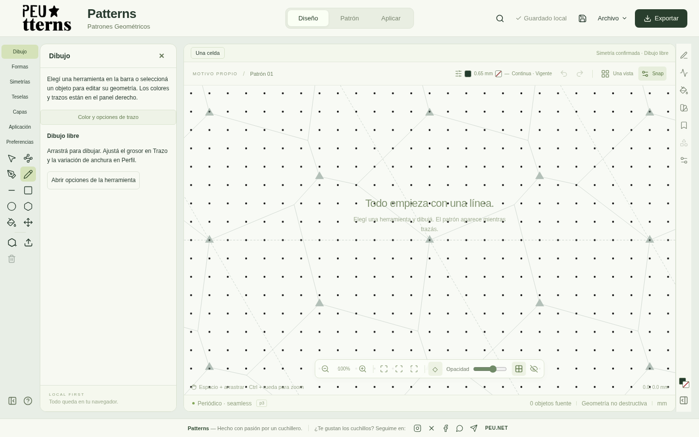

El botón del **cuadrado dividido en cuatro** muestra u oculta la grilla de puntos
negros cada **5 mm**. Es una referencia visual, independiente de la estructura
de simetría; **Snap** controla por separado el ajuste a grilla y nodos.

La pluma termina con Enter, se cierra con Shift+Enter o un clic sobre el primer nodo y se cancela con Esc. Espacio permite arrastrar la vista; Ctrl + rueda controla el zoom.

Con **Snap** activo, al dibujar o arrastrar un nodo éste se atrae al nodo más
cercano: aparece un círculo verde y las posiciones coinciden exactamente al
soltar. Funciona también sobre copias transformadas y permite acercar ambos
extremos de un mismo trazado. Ajustá **Preferencias → Distancia de atracción a
nodos** entre **1 y 40 px** (inicialmente **8 px**); la distancia visual se mantiene
al cambiar el zoom. El ajuste de nodos tiene prioridad sobre la grilla.
**Snap** en la barra controla la atracción entre nodos. **Preferencias → Ajustar
a grilla** es independiente: podés desactivarlo y mantener la atracción activa.
Los extremos snapeados guardan una unión permanente: al arrastrar uno acompañan
los demás trazos unidos, incluso después de guardar y abrir el archivo. Unir el
otro extremo conserva el primero. Alt al iniciar el arrastre permite separar
un extremo; los objetos bloqueados no se mueven.

**Clic derecho** termina la Bézier que estás dibujando. Fuera de un trazado activo,
abre un menú sobre la curva para **Añadir nodo aquí** sin cambiar su forma; sobre
un nodo permite **Eliminar nodo** o **Separar snap**. Estas acciones tienen deshacer.

Para rellenar áreas contiguas, dibujá su borde compartido una sola vez y completá
los otros lados. **Rellenar región** detecta cada área por separado aunque sus
límites sean trazos independientes; no hace falta fusionarlos en un único objeto.
La **Tolerancia de cierre de Fill**, en el panel derecho de Fill, permite salvar
pequeños huecos al calcular el relleno, sin mover los nodos originales. Es un
ajuste distinto de la distancia de atracción.
Las curvas Bézier abiertas se dibujan sin relleno implícito. El color elegido se
conserva para cuando se cierre el trazado; si se cierra con otros trazos, usá Fill
sobre el área resultante.

**Desplazar vista** está junto a los controles de zoom del área de trabajo.
En **Una celda**, la referencia permanece centrada y se puede acercar o alejar;
**Ajustar contenido** y **Restablecer vista** vuelven a mostrarla completa.
En móvil, el footer apila texto y enlaces sociales para mantenerlos visibles
sin desplazamiento horizontal.

Las preferencias de trabajo —Snap, grilla, radio de atracción, unidades,
vínculos/tolerancia de Fill y comportamiento de los paneles— se guardan en el
navegador y continúan entre proyectos. **Nuevo proyecto** restablece la geometría,
el encuadre y la herramienta acordados, conservando esos ajustes. Los fondos de
archivos y ejemplos se respetan; los estudios nuevos usan tu último fondo elegido.

## Encontrar herramientas y opciones

La barra izquierda abre un contexto a la vez. Las herramientas de dibujo
siguen disponibles directamente; los iconos muestran su nombre y atajo al
pasar el cursor. Cada panel se puede plegar. Las pestañas se recuerdan
durante la sesión y cambiar de contexto conserva el documento y la selección.

| Contexto | Qué contiene |
| --- | --- |
| Dibujo | Herramienta activa, instrucciones de pluma/lápiz/Fill/nodos y acceso a sus opciones |
| Formas | Polígono paramétrico con nombre y preview; figuras directas en la barra |
| Simetrías | Selector activo, recientes/favoritos, catálogo completo, red, colocación, generadores y composición |
| Teselas | Forma, colocación, bordes y tangentes |
| Capas | Objetos y conjuntos, visibilidad, bloqueo y orden |
| Aplicación | Perímetro, transformación y vínculo del patrón aplicado |
| Preferencias | Nombre del documento, guías, snap, unidades y fondo |

A la derecha están **Trazo, Perfil, Fill, Paleta, Presets, Objeto y Opciones**.
Fill comienza con azul y muestra el selector de color abierto; el campo HEX queda
debajo como alternativa. Elegir un color de relleno activa **Rellenar región**.
Los rellenos derivados se pintan debajo de los trazos que delimitan cada área.
**Fill** muestra directamente su color y opacidad; **Trazo** reúne color y
propiedades de línea. Los dos cuadrados de color al pie de la barra abren un
acceso conjunto a trazo y relleno, sin una pestaña Colores separada. Al seleccionar un objeto aparecen sus propiedades; sin selección,
se edita el estilo vigente. **Objeto** separa forma, transformación, nodos y
acciones geométricas. En ventanas estrechas los paneles funcionan como overlays
temporales y se alternan para dejar disponible el lienzo. Una barra de iconos
permanece en el borde derecho: cada icono abre directamente su sección; **Objeto**
se habilita al seleccionar una figura. El botón inferior pliega/despliega el
panel y recuerda la pestaña. Al abrir **Archivo** o **Exportar**, el panel derecho
se pliega primero, incluso si estaba fijado, para dejar libre el menú. Volver a pulsar **Rellenar región**, aunque ya esté
activo, vuelve a abrir sus controles; también funciona con **F**.

**Ctrl+K** abre la búsqueda: probá «polígono», «rellenar», «simetría p6m»,
«teselas», «grosor» o «exportar SVG». Flechas y Enter eligen una acción;
Escape cierra el buscador. La búsqueda usa las mismas acciones del editor.

**Referencias**, junto al botón de ayuda de atajos, abre un modal con scroll y
enlaces a los repositorios consultados y las bibliotecas del estudio.

## Ejemplos de uso

### Peces, aves, recursión y espirales

Abrí **Archivo → Galería de ejemplos**: hay dieciséis proyectos editables, con búsqueda,
filtros y miniaturas del resultado real. Ocho contienen dibujos vectoriales
originales. Los ocho ejemplos anteriores conservan sus accesos rápidos.

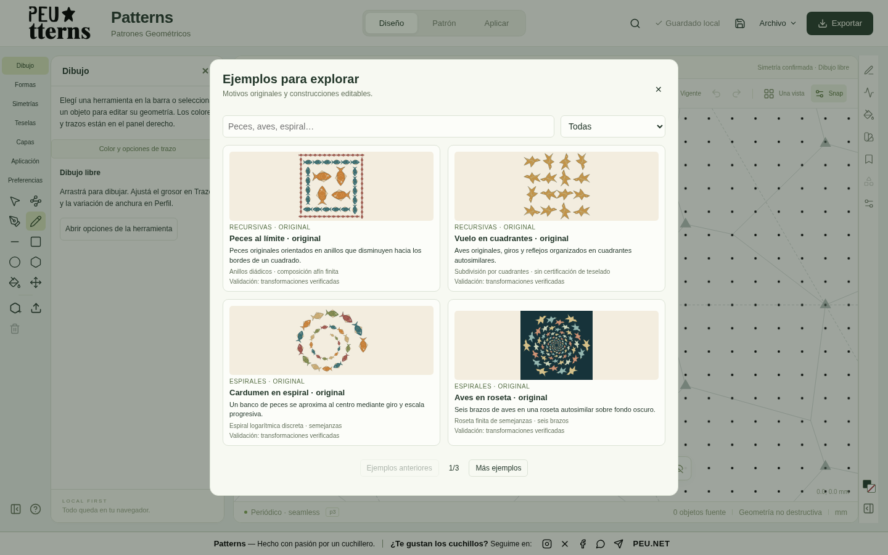

En **Peces al límite · original**, un único pez con aletas, ojos y detalles se
organiza en anillos cada vez menores hacia un borde cuadrado. Entrá en
**Simetrías → Composición** para cambiar la profundidad o activar reflejos.
**Editar motivo fuente** permite cambiar los nodos del pez; **Ver composición**
muestra el resultado actualizado. Las copias se calculan sin duplicar la fuente.

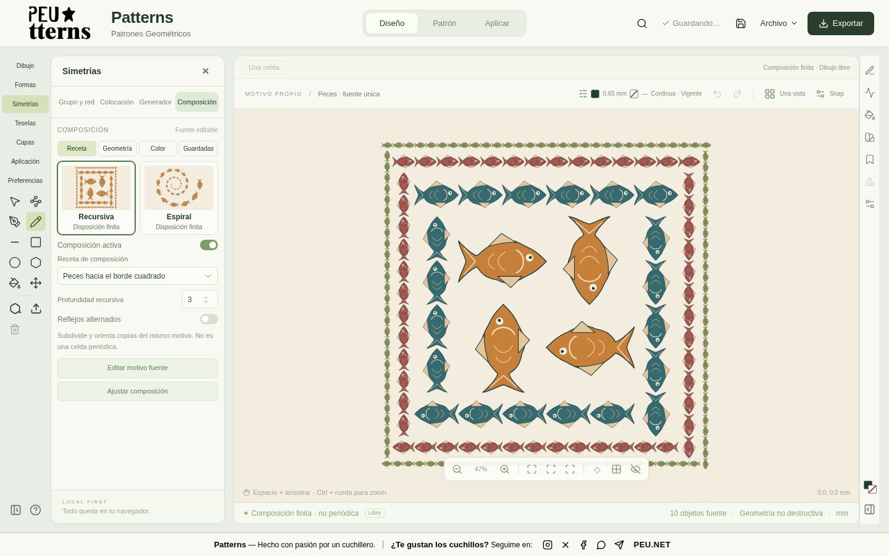

[Descargar peces al límite](docs/examples/v30-fish-square.json) ·
[Descargar aves en cuadrantes](docs/examples/v30-birds-quadrants.json).

En **Aves en roseta · original**, seis brazos combinan giro y escala sobre fondo
oscuro. La pestaña **Geometría** agrupa forma, posición y detalle: probá el ángulo,
la razón de escala o la cantidad de brazos. **Color** cambia la paleta por nivel
sin recolorear los ojos. Podés desactivar ese color por nivel para ver los colores
del motivo. **Guardadas** conserva recetas personales en este navegador; el JSON
del proyecto incluye la receta activa para trasladarla a otra PC.

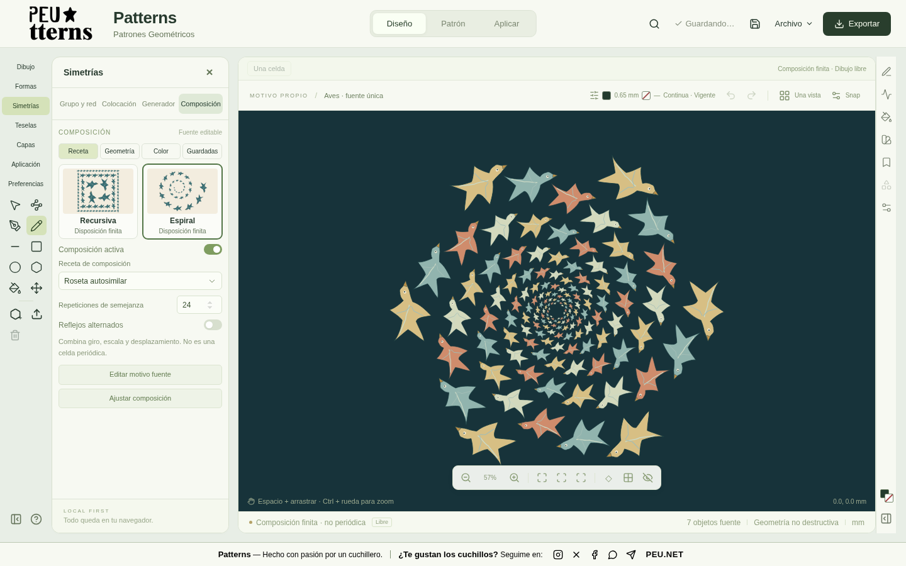

[Descargar aves en roseta](docs/examples/v30-birds-rosette.json) ·
[Descargar cardumen en espiral](docs/examples/v30-fish-spiral.json).

También podés componer tu propio dibujo: **Simetrías → Composición → Recursiva o
Espiral**. Recursiva ofrece anillos, cuadrantes y ramificación; Espiral ofrece
repetición discreta, logarítmica, roseta y convergencia hacia un punto fijo.
**Ajustar composición** encuadra todo el resultado. Ctrl+K encuentra estas funciones.

Son composiciones **finitas**, con transformaciones afines verificadas; no se
certifican como teselados sin huecos ni como geometría hiperbólica. Al activarlas,
la simetría y las teselas previas quedan guardadas; al desactivarlas vuelven a
usarse. El fondo de una tesela queda asociado a esa cobertura. El límite de detalle
y el presupuesto evitan una recursión ilimitada. SVG, PNG, JPEG y DXF usan la receta
guardada y medidas físicas independientes del zoom; DXF transporta contornos,
sin colores de relleno. La procedencia de cada ejemplo viaja en el JSON.

### Figuras que encastran: peces, aves y reptiles

En la categoría **Figurativas** hay peces **IH43**, aves **IH44**, reptiles
estilizados **IH1** y un ornamento de cuatro giros **IH63**. Son dibujos propios,
inspirados en la idea de división regular del plano; no son calcos de Escher.
Cada ejemplo incluye su clasificación y referencias.

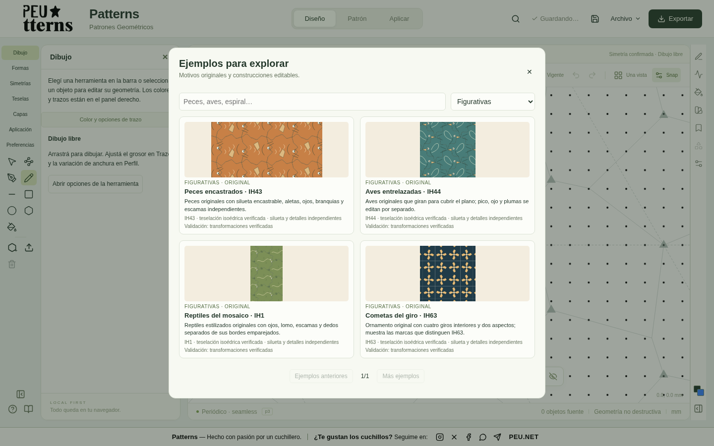

Abrí **Peces encastrados → Teselas → Bordes** y arrastrá un nodo: el borde
relacionado y la silueta se actualizan juntos. Ojos, aletas, plumas y escamas
siguen siendo objetos independientes. Las deformaciones inválidas conservan la
última forma válida. En **Simetrías → Composición**, una receta recursiva o espiral
puede usar la figura con su silueta enlazada, sin duplicar sus fuentes. El
ornamento IH63 muestra además sus marcas interiores de giro.

En **Teselas → Forma → Colores**, activá **Alternar colores de tesela** y elegí
una paleta de dos a seis colores. Fill sobre el fondo de una figura cambia su
clase de color en todo el mosaico, sin duplicar el dibujo. Los ejemplos ya
incluyen paletas. La celda repetible y su exportación incluyen el período de
color completo; puede ser mayor que la celda geométrica. La alternancia conserva
el encastre, aunque puede reducir las simetrías del resultado coloreado.

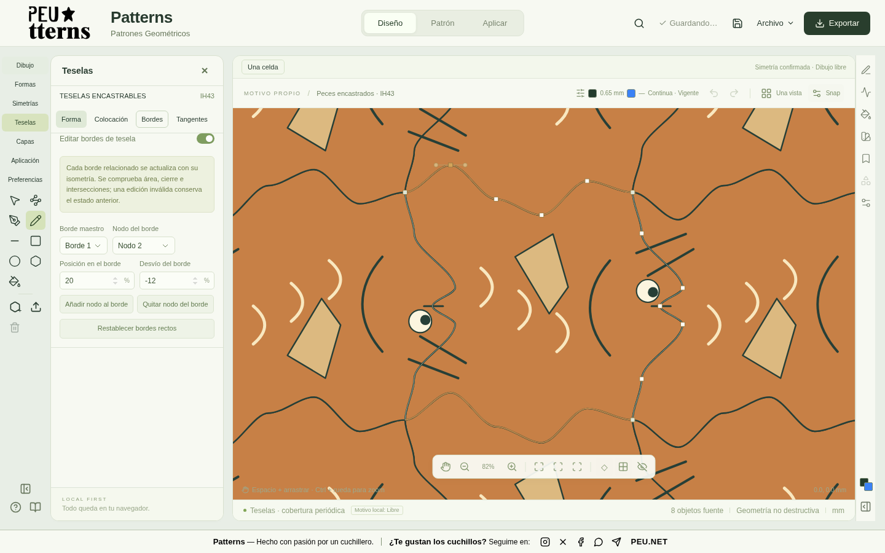

[Descargar peces IH43](docs/examples/v30-figurative-fish.json) ·
[Descargar aves IH44](docs/examples/v30-figurative-bird.json) ·
[Descargar reptiles IH1](docs/examples/v30-figurative-reptile.json) ·
[Descargar ornamento IH63](docs/examples/v30-figurative-abstract.json).

### Parches aperiódicos: Penrose, Hat y Spectre

En **Teselas**, cambiá la categoría **Encastre → Aperiódicas**. Elegí la
construcción, su semilla, sustituciones, tamaño y giro. **Color** permite pintar
por tipo, por grupo de una generación o por reflexión en Hat. **Jerarquía**
muestra los marcos de sustitución; son ayudas de lectura, no bordes de teselas.

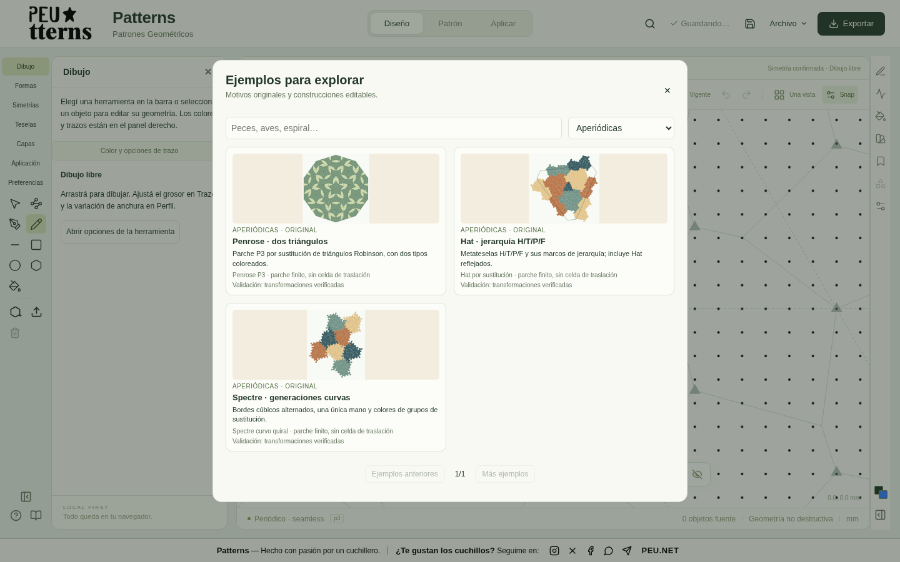

**Editar motivo fuente** abre una sola tesela de referencia. Dibujá sus detalles
y usá **Ver parche completo** para verlos propagados. Las copias usan matrices;
el archivo conserva una sola fuente. **Volver al motivo guardado** recupera el
dibujo sin convertir miles de copias en objetos. Fill persiste bajo los contornos.

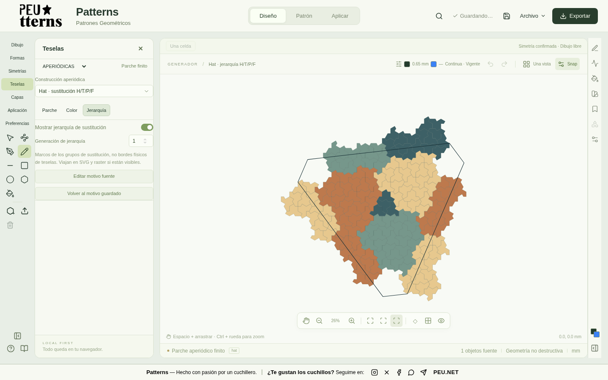

Son parches finitos de sistemas aperiódicos documentados: no tienen una celda
para repetir por traslación. Hat incluye las reflexiones que requiere su sistema;
Spectre usa bordes curvos y una sola mano. SVG editable reutiliza definiciones;
SVG expandido, PNG/JPEG y DXF conservan el resultado y sus medidas físicas.

[Penrose editable](docs/examples/v30-aperiodic-penrose.json) ·
[Hat con jerarquía](docs/examples/v30-aperiodic-hat.json) ·
[Spectre por generación](docs/examples/v30-aperiodic-spectre.json).

### Girih: estrellas y bandas entrelazadas

En **Teselas → Girih**, activá la construcción y elegí una roseta, una red de
rombos o una tesela del catálogo. El catálogo contiene decágono, pentágono,
hexágono alargado, corbatín y rombo72°. **Unir** permite agregar una forma por
un borde completo; rechaza colisiones y conserva el último parche válido.

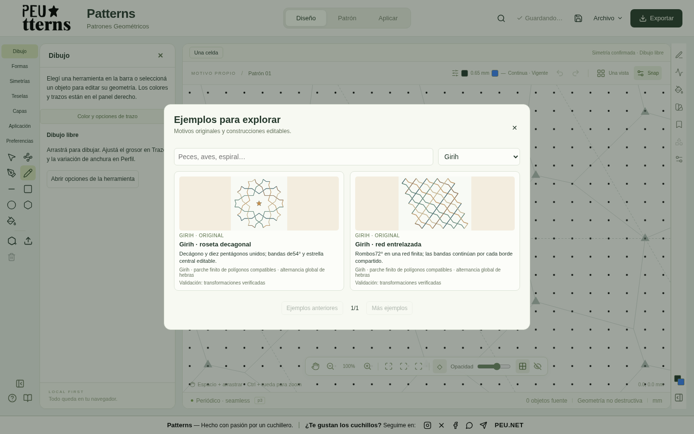

En **Bandas**, ajustá el ancho, la separación de los cruces y **Invertir
arriba/abajo**. El paso inferior se recorta de verdad: sus huecos viajan en SVG,
raster y DXF. La alternancia conecta las hebras a través de bordes compartidos;
girar o trasladar la construcción conserva sus relaciones de cruce.

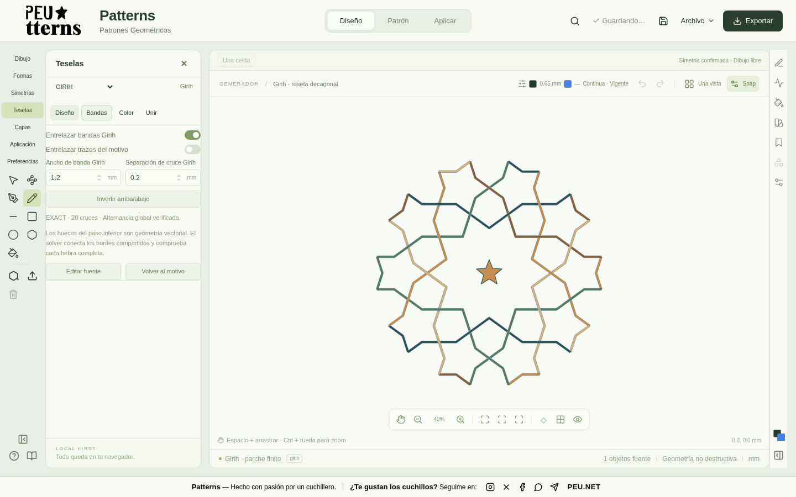

**Entrelazar trazos del motivo** también usa los ejes que dibujaste. **Editar
fuente** conserva los vectores originales; los ejes curvos se aproximan a0,02mm
antes de Colocación. Si un ciclo impide alternar, se informa el conflicto.
**Permitir cortes explícitos de alternancia** acepta las excepciones y las
identifica como resultado artístico. Un estiramiento desigual o una cizalla
se identifica también como artístico. Las construcciones son parches finitos,
con bordes y contactos verificados, sin afirmar cobertura infinita.

[Roseta Girih editable](docs/examples/v30-girih-rosette.json) ·
[Red entrelazada editable](docs/examples/v30-girih-rhombus-grid.json).

### Explorar un motivo sin perder el dibujo original

En **Archivo → Ejemplos editables**, abrí **Hexagonal · p6m** para obtener la escena de la primera imagen. Entrá en **Simetrías → Explorar todas las simetrías**. Pasá por p1, p4m y p6m y confirmá una opción. Las miniaturas se actualizan con tu motivo; la selección, la herramienta y las fuentes siguen disponibles. [Descargar este proyecto de ejemplo](docs/examples/studio-symmetry.json).

Diseño y Patrón son vistas de énfasis del mismo documento. **Vista dividida** muestra una celda editable, centrada a la izquierda, y la repetición a la derecha. Ambas comparten el zoom, incluso con la rueda. Al abrirla se ajusta la celda al espacio disponible. **Una celda** permite verla en un solo lienzo, también desde el modo Patrón. La celda queda centrada tanto aquí como en split; el zoom funciona con botones o Ctrl + rueda. Para desplazarte, volvé al patrón repetido. En patrones sin celda periódica se muestra el motivo completo. Los conjuntos pueden heredar la simetría principal, tener una propia o permanecer libres.

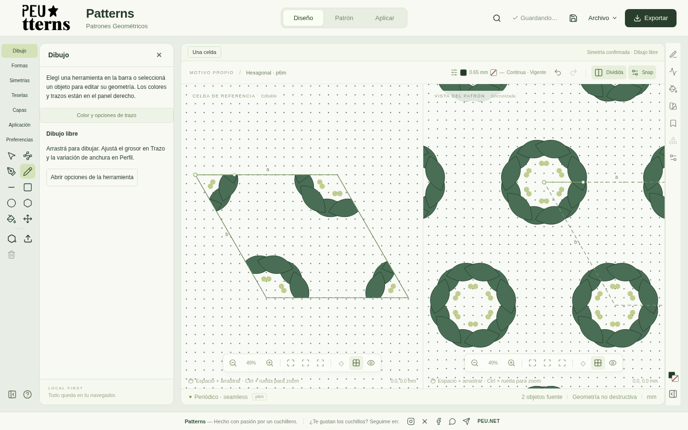

La celda de referencia recorta también el contorno de selección, los nodos y la previsualización de Fill. Si empezaste a dibujar fuera de ella, el original completo se conserva y la referencia muestra sólo la parte que corresponde a esa celda.

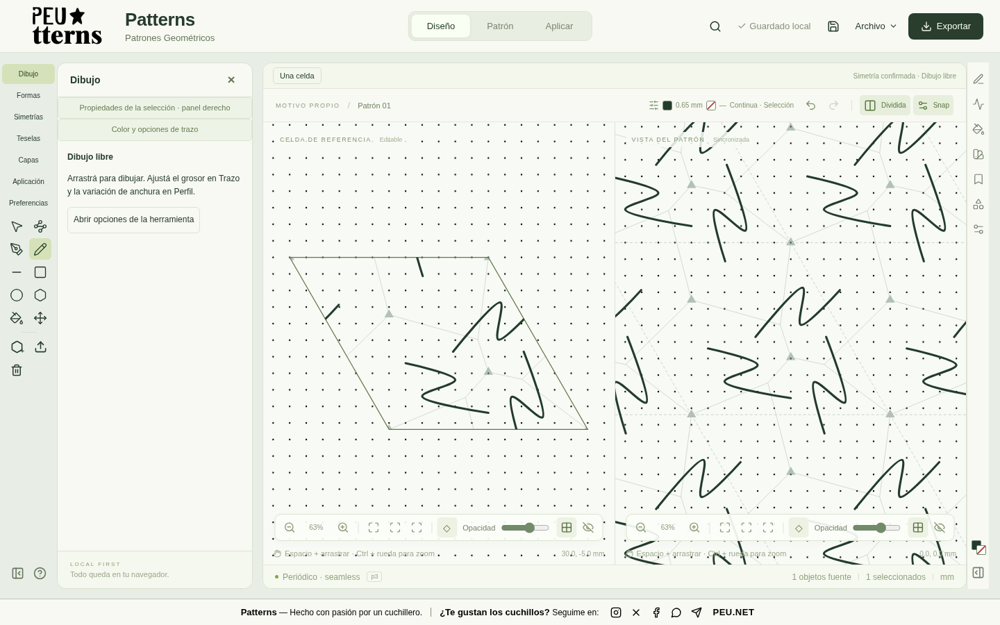

**Fuente pura** queda en **Preferencias → Vista avanzada**: permite editar los originales completos que cruzan varias celdas o revisar rellenos y patrones aperiódicos sin recorte. La escala **100%** equivale al antiguo **200%**; las medidas del documento y de las exportaciones conservan sus milímetros.


El catálogo ampliado muestra las 27 opciones con sus nombres matemáticos,
iconos y una vista de tu motivo. Filtrá por plano, friso o radial; en móvil,
las páginas mantienen accesible el catálogo completo. Las estrellas guardan
favoritos locales. Hover previsualiza; clic confirma y se puede deshacer.


### Crear y ajustar un polígono regular

Abrí **Formas → Polígono paramétrico · crear**. En el panel derecho,
**Objeto → Forma** muestra lados, ancho, alto, rotación, relleno y trazo.
Por ejemplo, elegí ocho lados y 42 × 42 mm; cada valor cambia la figura real.
Para moverla o reflejarla usá **Transformar**; para convertirla a paths,
**Nodos**. Las operaciones conservan undo/redo.


[Descargar el polígono paramétrico editable](docs/examples/parametric-polygon.json).

### Pintar una región formada por varias curvas

Dibujá cuatro segmentos o curvas que delimiten un área y elegí un color de relleno. Con **Rellenar región**, pulsá su interior: se crea un contorno vectorial editable y se conservan los trazos originales. La imagen muestra cuatro curvas independientes y un círculo interior: el hueco permanece vacío y el relleno se propaga por la repetición.


[Descargar el proyecto de las cuatro curvas](docs/examples/vector-fill.json) y abrirlo desde **Archivo** para inspeccionar las fuentes y el relleno.

El relleno puede quedar **vinculado** a sus límites o **fijo**. Si cambia una topología y el vínculo deja de ser válido, se conserva el último contorno y se muestra su estado; **Recalcular y vincular región** intenta recuperar una cara equivalente. Volver a pulsar una zona pintada permite recolorearla sin crear copias idénticas.

En patrones con simetría, el relleno se aplica a las instancias correspondientes
del mismo motivo, incluidas rotaciones y reflexiones. En **Penrose**, que es una
región aperiódica finita, pintás la cara elegida: el color queda sobre los fondos
del generador y debajo de los perímetros originales. Se conserva al salir del
área y al recargar, y se incluye en la exportación.

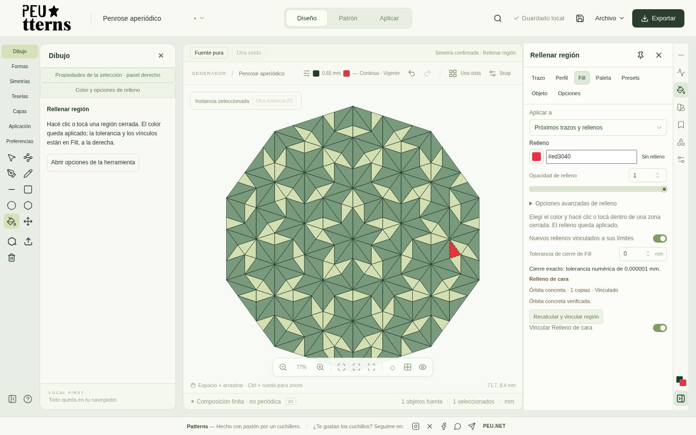

El lienzo queda libre de avisos permanentes de curvas. El progreso y Cancelar
cálculo aparecen sólo cuando una operación tarda; Otra región se ofrece cuando
hay más de una opción bajo el puntero.

Por defecto se exige cierre geométrico dentro del epsilon numérico. Para pequeños huecos, aumentá explícitamente **Tolerancia de cierre de Fill** en el panel derecho; esta opción no modifica los trazos originales. Las guías y los espejos de estructura no cuentan como límites materiales.

### Construir teselas con bordes curvos

Abrí **Teselas → Forma** y elegí una familia. Entrá en **Bordes** para editar nodos y en **Tangentes** para ajustar las curvas. Al mover nodos y tangentes, los bordes correspondientes cambian juntos para conservar el encastre. Pintá el interior con Fill y seguí dibujando sobre las copias.


[Descargar el proyecto de teselas curvas](docs/examples/curved-tiles.json) para explorar sus bordes y su fondo por separado.

Hay cuadrados, rectángulos, paralelogramos, triángulos equiláteros y hexágonos regulares. Los vértices estructurales permanecen fijos y las curvas se limitan a corredores seguros. En triángulos se edita media curva y se deriva su pareja mediante simetría central. No se ofrecen polígonos arbitrarios como si pudieran teselar.

El dibujo interior y el contorno de tesela son entidades diferentes. Ajustar al patrón encuadra la tesela de referencia. Para incluir el contorno en SVG, DXF o raster, activá **Exportar contornos de teselas**. Las aristas compartidas se deduplican. El generador legado **Motivos escalonados** y la región aperiódica finita de Penrose siguen disponibles por separado.

### Explorar teselas isoédricas

**Teselas → Explorar catálogo IH1–IH93** abre un catálogo con búsqueda por IH,
filtros de traslaciones/giros/reflexiones y vistas de la tesela y su mosaico.
Podés elegir bordes rectos o una curva inicial y seguir editando nodos y
tangentes. Los detalles del motivo se conservan al cambiar de construcción.


Los **93 tipos están verificados**:81 se expresan mediante su geometría y12
requieren marcas interiores. En estos últimos los bordes son rectos y el motivo
se repite también dentro de la tesela para respetar su grupo. **Forma** muestra sus parámetros
por páginas; **Bordes** y **Tangentes** controlan las curvas relacionadas. Añadir
un nodo conserva la curva. Si una edición cruza la silueta, invierte su
orientación o solapa vecinos, se conserva la última versión válida. Los bordes
que deben ser ejes de espejo permanecen rectos. Ctrl+K encuentra el catálogo.


### Ajustar apariencia, guardar estilos y componer

En el panel derecho, **Fill** ofrece color HEX/alfa y opacidad del relleno; **Trazo**, color de línea, grosor, extremos y uniones; **Perfil**, curva de anchura. La regla de relleno queda en las opciones avanzadas de Fill: decide qué partes se pintan en contornos cruzados o con agujeros. Para el uso habitual se puede dejar Par / impar. Las paletas y los presets tienen sus propias pestañas. Guardá un estilo con nombre para reutilizar sus valores sin modificar retroactivamente los objetos anteriores. El indicador compacto sigue visible al cerrar el panel; podés fijarlo abierto o dejar que se autocierre al volver al lienzo.

**Capas** permite ocultar, bloquear y ordenar objetos; **Objeto → Forma** permite nombrarlos. En **Aplicar**, creá o importá un perímetro cerrado y colocá el conjunto sobre él. Una aplicación congelada conserva su simetría efectiva aunque cambie la principal. El exportador permite elegir el conjunto activo o la composición visible; sólo ofrece una celda común cuando su periodicidad está verificada.

El pie de página usa negro de alto contraste y destaca en negrita a 13px Patterns, ¿Te gustan los cuchillos? y PEU.NET; «Seguime en:» conserva el peso normal. Reúne los enlaces del autor en una línea: **Patterns — Hecho
con pasión por un cuchillero. ¿Te gustan los cuchillos? Seguime en:**, con
Instagram, X, Facebook, WhatsApp, Telegram y PEU.NET. En pantallas estrechas
se puede recorrer horizontalmente. Los iconos de pestaña, favoritos y pantalla
de inicio usan los archivos actualizados aportados en favicon_io.zip; el manifest
conserva rutas relativas para raíz y subcarpetas. Sus URLs incluyen una revisión
para actualizar también los iconos que el navegador tenía en caché.

Al compartir la página, las tarjetas de Open Graph y X/Twitter usan la
carátula aportada por el autor, con título, descripción y texto alternativo.
La imagen se publica como `caratula.jpg`; conserva el JPEG original de
1176 × 775, sin recortes ni cambios en el logo del editor. La URL canónica
es `https://peu.net/pattern/`; los enlaces de la imagen son absolutos para
que las redes puedan leerlos sin ejecutar JavaScript.

## Guardado y privacidad

El autosave transaccional usa IndexedDB y guarda cada proyecto por su ID. Los favoritos de simetría se guardan en este navegador y los recientes duran la sesión. Estas preferencias de navegación no cambian el JSON ni agregan undo. La biblioteca pertenece al navegador y al origen HTTP (host y puerto). Otra PC puede revisar la aplicación y sus ejemplos, pero no ve automáticamente los proyectos privados de tu navegador. Para intercambiarlos, guardá y abrí JSON.

El guardado explícito descarga un archivo completo y también intenta completar la escritura local. Si el navegador rechaza IndexedDB, la aplicación informa el error y el JSON sigue disponible. Un perímetro a medio dibujar no reemplaza el último autosave válido.

La galería de Archivo reúne doce ejemplos editables y conserva ocho accesos rápidos. Abrir ejemplos o crear proyectos conserva los anteriores en **Biblioteca de este navegador**. El logo visible usa el archivo local `src/assets/icono.png` aportado por el usuario.

## Alcances y límites

Los frisos repiten en una dirección; las rosetas y Penrose son construcciones finitas. Una red oblicua arbitraria no se presenta como baldosa rectangular seamless. Los grupos triangulares sí admiten una supercelda rectangular de alto `sqrt(3)·ancho`.

Los generadores Wave/Guilloché/Spirograph/Rosette producen paths muestreados determinísticos; sus archivos contienen exactamente esa geometría vectorial. DXF aproxima las Bézier con tolerancia configurable y conserva mm; no conserva rellenos ni edición paramétrica.

La importación SVG admite paths, formas, grupos y referencias locales compatibles. Elimina scripts, recursos externos, imágenes, texto, filtros, gradientes y otras capacidades no admitidas, informando su eliminación. La opacidad de grupo se aplica por objeto y se advierte la posible diferencia en superposiciones. Las exportaciones SVG expandidas convierten trazos a contornos por defecto para preservar su recorte y apariencia; al desactivarlo se exportan líneas centrales recortadas.

Se limitan las escenas a 20.000 transformaciones y las expansiones a 150.000 trazados; las imágenes raster se limitan a 64 millones de píxeles. Los objetivos interactivos son mediciones de referencia, no garantías para cualquier complejidad.

Fill limita cada análisis a 1.200 entradas/curvas, 20.000 intersecciones, 40.000 medias aristas y 2.000 caras. Si las repeticiones superan ese presupuesto en la vista completa, pasa automáticamente a analizar la región clickeada. Conserva curvas, agujeros y fuentes; un objeto ya cerrado puede recolorearse directamente aunque tenga más de 1.200 curvas. Una región cuya complejidad local excede esos límites sigue requiriendo simplificar los límites. Los contornos de trazo tienen presupuestos de muestras y subdivisiones: si una combinación excede los límites, la vista ofrece corregir el estilo y el exportador informa el error. No se sustituye silenciosamente el resultado exportado por una imagen o un eje provisional. La tolerancia física se ajusta a las transformaciones afines.

## Instalación y ejecución

Requisitos de desarrollo: Node.js 22.12 o posterior, npm; Python 3 para las herramientas LAN. Se usa únicamente npm y el lockfile incluido.

```bash
npm ci
npm run dev
```

Abrir `http://localhost:4173` o `http://<IP_LOCAL>:4173` desde otra PC. El servidor Debian no necesita escritorio ni GPU. El navegador cliente realiza el trabajo geométrico.

Para mantener y administrar los servicios locales sin una terminal abierta:

```bash
npm run local:start
npm run local:status
npm run local:stop
```

`local:start` reutiliza los procesos propios activos y rechaza puertos ocupados por otros servicios. Los PIDs y logs quedan en `.runtime/`. Para iniciar el monitor por primera vez fuera de la sesión Codex original, usar `python3 scripts/local-services.py start --thread UUID-DEL-HILO`.

### Revisión desde la red local

- Estudio en vivo: `http://<IP_LOCAL>:4173`
- Avances, commits, cupo y feedback: `http://<IP_LOCAL>:4174`

Reemplazar `<IP_LOCAL>` por la dirección de la máquina que ejecuta los servicios. Consultarla localmente con `hostname -I`; puede cambiar con DHCP. Las direcciones concretas se mantienen fuera del repositorio. Se mantiene el servidor de desarrollo para que las revisiones aparezcan al guardar código.

El panel de avances es una herramienta de desarrollo independiente. No se distribuye como requisito del producto ni expone archivos de sesiones, credenciales o proyectos del navegador.

### Compilar y desplegar

```bash
npm run build
npm run serve:dist
```

Abrir `http://localhost:4180`. `dist/` contiene únicamente archivos estáticos y avisos de licencias. Copiar su contenido por FTP o a un servidor HTTP convencional. No subir `node_modules/`, `.runtime/`, `.git/` ni las sesiones de Codex.

La ruta relativa predeterminada permite raíz y subdirectorios. Para fijar una base concreta:

```bash
BASE_PATH=/pattern/ npm run build
```

Copiar `dist/` al subdirectorio `/pattern/`. No se necesitan reglas de reescritura: la aplicación usa un único documento HTML. HTTP por LAN funciona; no depende de service workers, contexto HTTPS, CDN, fuentes externas ni conexión a Internet. Hace falta servir los archivos por HTTP; no se promete abrir el worker mediante `file://`.

### Despliegue automático por FTP con GitHub Actions

[Deploy FTP](.github/workflows/deploy-ftp.yml) se ejecuta con **cada push**,
sin filtros de rama ni de archivos, y también desde **Actions → Deploy FTP →
Run workflow**. Instala con `npm ci`, verifica TypeScript y pruebas, compila
con rutas relativas y sube únicamente el contenido de `dist/`.

Configurar estos cuatro **Repository secrets** en Settings → Secrets and
variables → Actions:

| Secret | Contenido |
| --- | --- |
| `FTP_HOST` | Host FTP, sin prefijo `ftp://` |
| `FTP_USERNAME` | Usuario de la cuenta FTP |
| `FTP_PASSWORD` | Contraseña FTP |
| `FTP_FOLDER` | Carpeta de la aplicación dentro de `public_html` |

Con `FTP_FOLDER=pattern`, el destino es **`public_html/pattern/`**. No hace
falta escribir la barra final: el workflow la agrega. También admite
`pattern/` o `public_html/pattern/` sin duplicar el prefijo. La ruta es relativa
a la carpeta inicial de la cuenta FTP, que debe tener acceso a `public_html`.
El build usa `./` como base, independientemente del nombre de esa carpeta.

Las subidas se ejecutan de a una; un push nuevo no interrumpe una transferencia
activa. Se sincronizan archivos de la aplicación mediante el estado de la
action, sin vaciar la carpeta completa ni subir el código fuente, el monitor,
`.runtime/` o las credenciales. El protocolo configurado es FTP, puerto 21.
Para ver el resultado de una publicación, abrir su ejecución en **Actions**.

Primera publicación verificada: [ejecución correcta en GitHub Actions](https://github.com/pablopeu/pattern/actions/runs/44744523772).

Validación local de la normalización del destino: `npm run test:deploy`.
Referencia: [configuración de FTP Deploy Action](https://github.com/SamKirkland/FTP-Deploy-Action#settings).

## Desarrollo y seguimiento del trabajo

### Verificación

```bash
npm run check
npm run test:monitor
npx playwright install chromium
npm run test:e2e
npm run benchmark
```

V2.3 verificado: **203 pruebas unitarias, 94 flujos E2E, 9 pruebas del monitor y 6 pruebas estáticas**. Se conservan los 75 recorridos anteriores. Builds raíz/subdirectorio y validación independiente de exportaciones correctos.

El benchmark necesita el servidor de desarrollo. Las pruebas estáticas y la validación independiente de archivos se explican en [TESTING.md](docs/TESTING.md). Resultados anteriores: [docs/ACCEPTANCE.md](docs/ACCEPTANCE.md). Auditoría UX: [docs/ACCEPTANCE_V23.md](docs/ACCEPTANCE_V23.md) e [inventario de funciones](docs/UX_V23_INVENTORY.md).

Para regenerar las cinco capturas y los cuatro JSON de ejemplo de este README con el servidor local activo: `node scripts/capture-readme.mjs`. Se usa un navegador aislado; no se modifican los proyectos del navegador del usuario.

### Monitor de cupo y feedback

```bash
npm run monitor
python3 scripts/work_monitor.py --status
```

Lee únicamente los eventos `rate_limits` del hilo local identificado por `CODEX_THREAD_ID`, `--thread` o el ID recordado en `.runtime/thread-id`. Publica porcentajes, timestamps de observación y reset, historial Git local y documentación.

Con 10% o menos disponible en la ventana primaria de 5 horas, pide cerrar el incremento y guarda un timer. Después del reset real primario +60 segundos solicita reanudar **el mismo hilo** mediante `codex queue --resume`. El cupo secundario/semanal sólo envía un aviso: Pablo decide si usa un banked reset; no pausa el trabajo ni retrasa el timer al reset semanal. No cambia límites ni inventa un cupo nuevo al vencer el reloj. El agente verifica la telemetría al continuar. La reanudación necesita que la máquina y el daemon local de Codex sigan disponibles; cualquier fallo queda registrado en `.runtime/monitor-events.jsonl`.

El feedback del panel se guarda en `.runtime/feedback.jsonl` y se envía a esta conversación mediante una cola independiente del cupo, aunque el agente esté trabajando o esperando el reset. El dashboard distingue **Entrega pendiente**, **En conversación** y **Revisado**. Los fallos se reintentan; el registro local de entregas evita reenvíos normales tras reiniciar. «En conversación» confirma el encolado, no que el agente ya lo haya leído. El archivo `.runtime/STOP` desactiva el ciclo del monitor; `.runtime/PROJECT_COMPLETE` indica que el PRD fue verificado y cancela reanudaciones pendientes. Los procesos de revisión permanecen en LAN. Remoto de código autorizado: [pablopeu/pattern](https://github.com/pablopeu/pattern), rama `main`.

### Documentación técnica

- [ARCHITECTURE.md](docs/ARCHITECTURE.md): módulos, flujo de datos y renderizado.
- [GEOMETRY.md](docs/GEOMETRY.md): grupos, redes, precisión y límites matemáticos.
- [PROJECT_FORMAT.md](docs/PROJECT_FORMAT.md): formato, recuperación y migraciones.
- [TESTING.md](docs/TESTING.md): pruebas, benchmark y validadores externos.
- [THIRD_PARTY_NOTICES.md](docs/THIRD_PARTY_NOTICES.md): dependencias y referencias inspeccionadas.
- [docs/PROGRESS.md](docs/PROGRESS.md): registro de avances y correcciones.
