# Pattern Studio 2D

English · [Español](#español)

A vector studio for drawing motifs, exploring symmetries and building editable patterns and tiles. Your drawing repeats while you work: every copy shares one canonical source, so editing one updates the whole pattern.

It runs in the browser, processes all geometry locally and can be deployed as static files. No accounts, APIs or external services required.

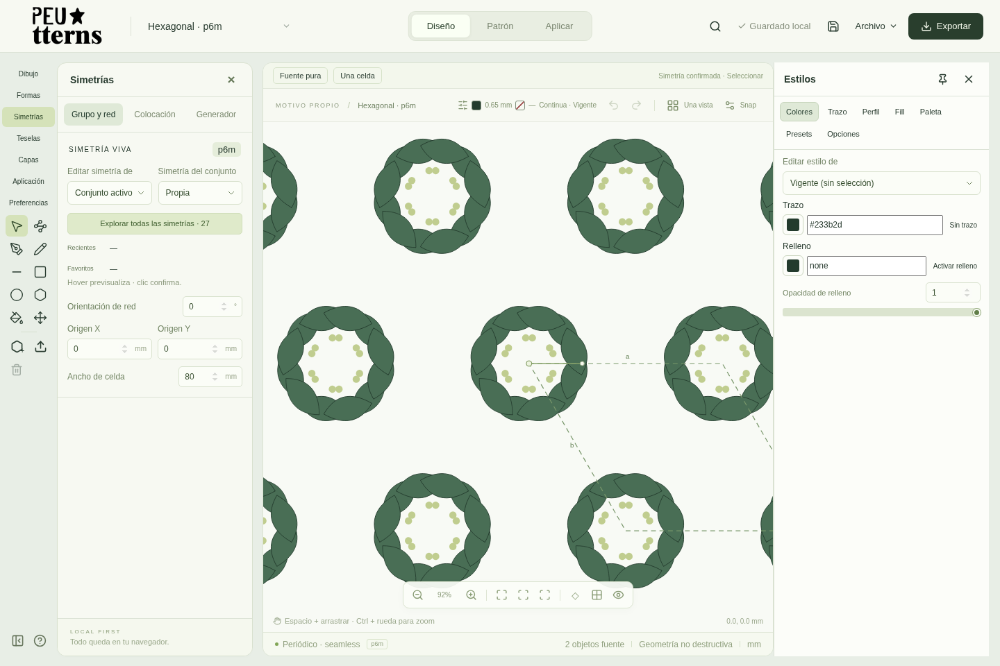

## What you can create

- Freehand motifs, lines, Bézier curves and closed shapes, with physical measurements in millimetres.
- Patterns with the 17 wallpaper groups, seven friezes and radial symmetries. Thumbnails use your own drawing to show what each option does.
- Continuous, dotted or custom strokes; variable-width profiles, colours, opacities, palettes and saved styles.
- Vector fills for closed objects or regions bounded by several strokes, including from reflected or rotated copies.
- Interlocking tiles with curved edges and patterns applied to perimeters with holes.
- Recursive and spiral compositions from one editable motif, with per-level palettes and saved recipes.
- Editable JSON files and SVG, PNG, JPEG and DXF exports.

## Getting started

1. Open **File → New project**. The study starts in **P3**, at **100 %** zoom, with a centred origin, structure visible at **50 %** and **Free draw** active. Drag to draw; you can also pick line, pen or shapes.
2. Choose colour and width in **Stroke** (pencil icon; a **0–2 mm** slider, with numeric entry for other widths), or the fill colour in **Fill**. **Apply to** edits the selected objects or what you are about to draw.
3. Open **Symmetries → Group and lattice** in the left bar. Hover the **Live symmetry** thumbnails to explore. Click, Enter or Space confirm a group and keep your sources. You can keep drawing from any copy.
4. Choose **Fill region** and click inside a closed area. The colour is applied when you move the pointer away; on a touch screen a tap is enough. Undo reverts the operation. No confirmation button is needed.
5. Use **File → Save JSON file** to keep editing later. Saving asks for a name; if you have not chosen one, it suggests **Study-YY-MM-DD-HH-MM** with your local date and time. You can also edit it in File. Use **Export** to get the final result.

P3 heads the catalogue and **Free** stays at the end; the rest keep their order.
Recovered projects keep their saved symmetry and preferences. The active tool
starts as Free draw. On mobile, panels start collapsed to leave the canvas clear.


The **square divided in four** button shows or hides the black dot grid every
**5 mm**. It is a visual reference, independent of the symmetry structure;
**Snap** controls grid and node snapping separately.

The pen finishes with Enter, closes with Shift+Enter or a click on the first node, and cancels with Esc. Space pans the view; Ctrl + wheel controls zoom.

With **Snap** active, drawing or dragging a node attracts it to the nearest
node: a green circle appears and positions match exactly when released. It also
works on transformed copies and can bring both endpoints of the same path
together. Adjust **Preferences → Node attraction distance** between **1 and
40 px** (initially **8 px**); the visual distance is kept when zooming. Node
snapping takes priority over the grid. **Snap** in the bar controls
node-to-node attraction. **Preferences → Snap to grid** is independent: you can
turn it off and keep attraction on. Snapped endpoints store a permanent joint:
dragging one brings the other joined strokes along, even after saving and
reopening the file. Joining the other endpoint keeps the first one. Alt at the
start of a drag separates an endpoint; locked objects do not move.

**Right click** ends the Bézier you are drawing. Outside an active path, it
opens a menu on the curve for **Add node here** without changing its shape; on
a node it offers **Delete node** or **Detach snap**. These actions can be undone.

To fill adjacent areas, draw their shared border once and complete the other
sides. **Fill region** detects each area separately even when its boundaries are
independent strokes; there is no need to merge them into a single object. The
**Fill closure tolerance**, in the right-side Fill panel, saves small gaps when
computing the fill without moving the original nodes. It is a different setting
from the attraction distance. Open Bézier curves are drawn without an implicit
fill. The chosen colour is kept for when the path is closed; if it is closed by
other strokes, use Fill on the resulting area.

**Pan view** sits next to the workspace zoom controls.
In **One cell**, the reference stays centred and can be zoomed in or out;
**Fit content** and **Reset view** bring back the full view.
On mobile, the footer stacks text and social links to keep them visible
without horizontal scrolling.

Working preferences —Snap, grid, attraction radius, units,
Fill links/tolerance and panel behaviour— are stored in the
browser and carry across projects. **New project** resets geometry,
framing and the agreed tool while keeping those settings. Backgrounds of
files and examples are respected; new studies use your last chosen background.

## Finding tools and options

The left bar opens one context at a time. Drawing tools
remain directly available; icons show their name and shortcut on
hover. Each panel can be collapsed. Tabs are remembered
for the session and switching context keeps the document and selection.

| Context | What it contains |
| --- | --- |
| Symmetries | Explorer, recent/favourites, lattice, placement, generators and composition |
| Tiles | Visual families Interlock, Aperiodic and Girih; IH catalogue and contextual parameters |
| Layers | Objects in the set, visibility, locking and set management |
| Preferences | Guides, Snap, units and background |

Draw and Shapes have no separate entry: their tools act directly and
their parameters are on the right. The hexagon with **+** creates the regular polygon.
**Apply**, at the top, opens perimeters and placement directly, with no extra
side entry. **Design** lets you edit and split the view; **Pattern** shows a
single full view and also allows editing. All three use the same document.

In Symmetries, **Change symmetry in → This set** modifies only the active set;
**Shared** modifies the configuration followed by sets that use it.
**This set's repetition** chooses Own, Shared or No repetition. The star
next to the explorer marks the current one as a favourite. **Orientation and
origin** groups the sliders; fine adjustment in P3 is provisionally ±6°, with
numeric entry for other values. Moving or rotating the lattice keeps the joins
between copies.

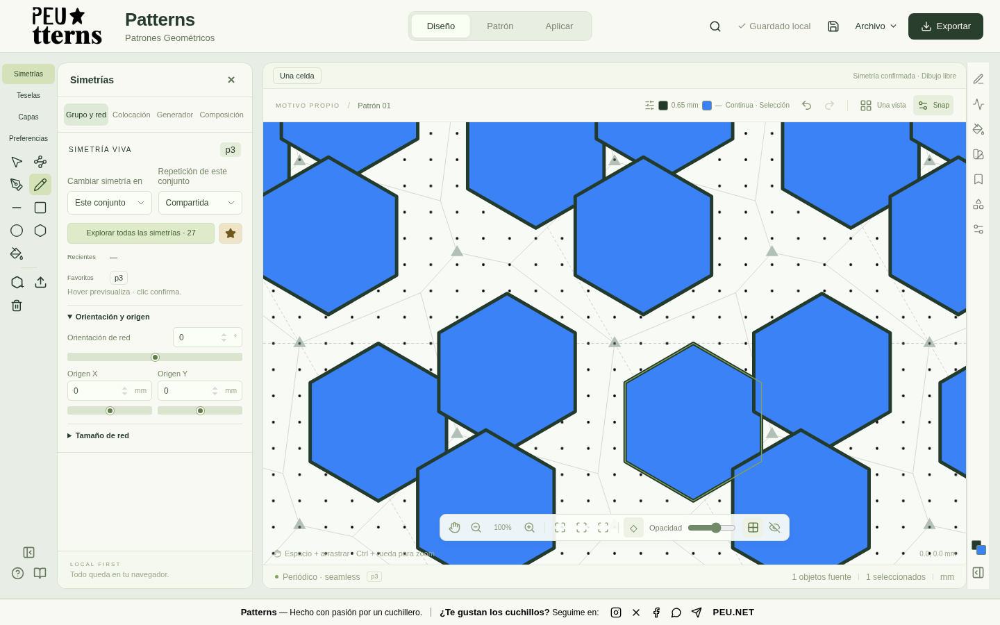


**Layers → Objects** lists strokes, shapes and fills; the padlock prevents
selecting, editing or deleting them by accident and lets you unlock them.
**Sets** groups many objects: another closed region stays in the same set until
you choose **New set**. The active one shows where the next strokes go. The
[workspace guide](docs/WORKSPACE_GUIDE.md) explains these controls and modes.

On the right are **Stroke, Profile, Fill, Palette, Presets, Object and Options**.
Fill starts with blue and shows the colour picker open; the HEX field stays
below as an alternative. Choosing a fill colour activates **Fill region**.
Derived fills are painted below the strokes bounding each area.
**Fill** shows its colour and opacity directly; **Stroke** groups colour and
line properties. The two colour squares at the foot of the bar open combined
access to stroke and fill, with no separate Colours tab. Selecting an object shows its
properties; with no selection, the current style is edited. **Object** separates
shape, transformation, nodes and geometric actions. In narrow windows panels
work as temporary overlays and alternate to leave the canvas available. An icon
bar stays on the right edge: each icon opens its section directly; **Object**
becomes available when a shape is selected. The bottom button collapses/expands
the panel and remembers the tab. Opening **File** or **Export** collapses the
right panel first, even if it was pinned, to leave the menu clear. Pressing
**Fill region** again, even when active, reopens its controls; **F** works too.

**Ctrl+K** opens search: try "polygon", "fill", "p6m symmetry",
"tiles", "width" or "export SVG". Arrows and Enter choose an action;
Escape closes the search. Search uses the same editor actions.

**References**, next to the shortcuts help button, opens a scrollable modal with
links to the repositories consulted and the studio's libraries.

## Usage examples

### Fish, birds, recursion and spirals

Open **File → Example gallery**: there are **23 studies**, with
search, categories and thumbnails of the real result. Cards are paginated
according to screen size; the dialog fits completely with no scrollbars.

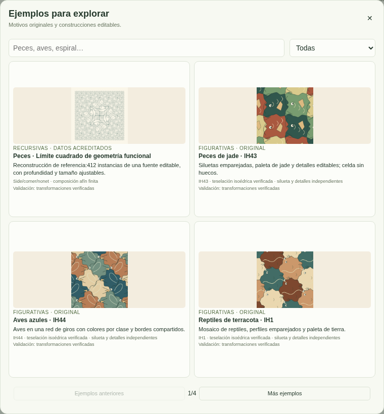

**Fish · Square limit of functional geometry** uses the credited vector data
from *Programming with Escher*. One source and 412 instances form the classic
construction. In **Symmetries → Composition**, depth 0–5 changes the detail;
**Edit source motif** lets you modify the fish. The data and its GPL3 licence
are kept in the repository and in the notices; JSON and SVG carry their
provenance. No image of the print is included.

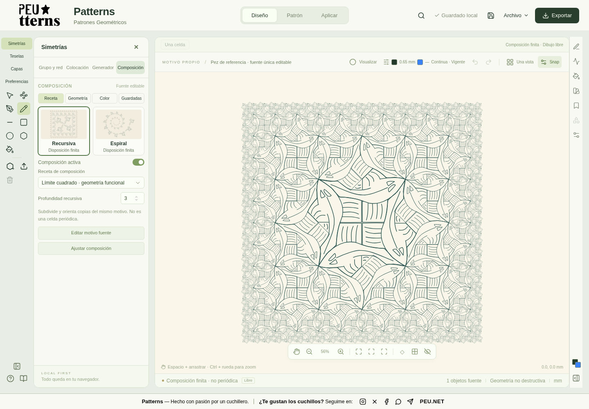

[Download the editable study](docs/examples/v3-escher-square.pattern.json) ·
[Source and attribution](https://github.com/mapio/programming-with-escher).

**Fish · Self-similar rosette** lets you try rotation, scale, arms and palette.
It is a finite artistic exercise: spaces are intentional. For continuous
interlocks, choose the **Figurative** category or the Poincaré examples with
shared edges.

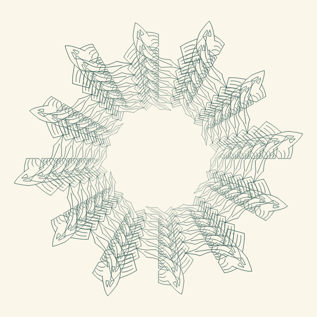

[Download the rosette](docs/examples/gallery-spiral.pattern.json).

Each family and recipe remembers its parameters and colours. You can switch
between recursive, spiral and recipes, go back, and recover the previous result,
also when reopening the JSON. The source and tile fills are kept; they are not
replaced when exploring other layouts.

You can also compose your own drawing: **Symmetries → Composition → Recursive or
Spiral**. Recursive offers functional geometry, rings, quadrants and branching;
Spiral offers discrete repetition, logarithmic, rosette and convergence towards
a fixed point. **Fit composition** frames the whole result. Ctrl+K finds these functions.

They are **finite** compositions with verified affine transformations; they are
not certified as gapless tilings or as hyperbolic geometry. When enabled,
previous symmetry and tiles are stored; when disabled they are used again. A
tile background stays associated with that coverage. The detail limit and
budget prevent unlimited recursion. SVG, PNG, JPEG and DXF use the stored recipe
and physical measurements independent of zoom; DXF carries outlines
without fill colours. Each example's provenance travels in the JSON.

### Interlocking figures: fish, birds and reptiles

The **Figurative** category has **IH43** fish, **IH44** birds, stylised
**IH1** reptiles and a four-fold **IH63** ornament. They are original drawings,
inspired by the idea of regular plane division; they are not Escher tracings.
Each example includes its classification and references.

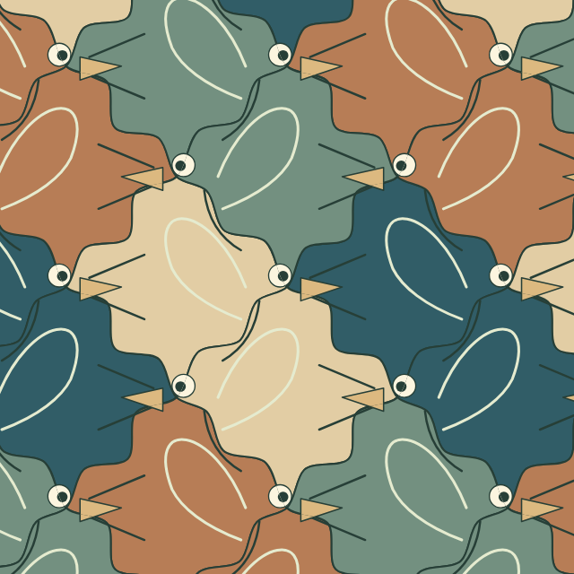

Open **Jade fish → Tiles → Edges** and drag a node: the related edge and the
silhouette update together. Eyes, fins, feathers and scales remain independent
objects. Invalid deformations keep the last valid shape. In **Symmetries →
Composition**, a recursive or spiral recipe can use the figure with its linked
silhouette, without duplicating its sources. The IH63 ornament also shows its
interior rotation marks.

In **Tiles → Shape → Colours**, enable **Alternate tile colours** and choose a
palette of two to six colours. Fill on a figure's background changes its colour
class across the mosaic, without duplicating the drawing. The examples already
include palettes. The repeatable cell and its export include the full colour
period; it may be larger than the geometric cell. Alternation keeps the
interlock, although it may reduce the symmetries of the coloured result.

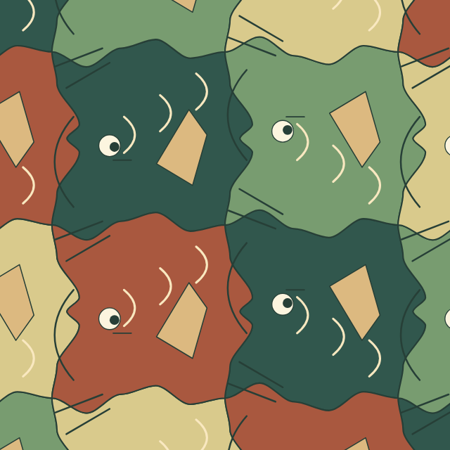

[Download IH43 fish](docs/examples/gallery-fish.pattern.json) ·
[Download IH44 birds](docs/examples/gallery-bird.pattern.json) ·
[Download IH1 reptiles](docs/examples/gallery-reptile.pattern.json) ·
[Download IH63 ornament](docs/examples/gallery-abstract.pattern.json).

### Aperiodic patches: Penrose, Hat and Spectre

In **Tiles**, switch the category **Interlock → Aperiodic**. Choose the
construction, its seed, substitutions, size and rotation. **Colour** paints
by type, by generation group or by reflection in Hat. **Hierarchy** shows the
substitution frames; they are reading aids, not tile edges.

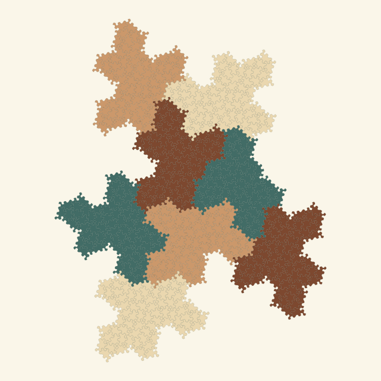

**Edit source motif** opens a single reference tile. Draw its details and use
**See full patch** to see them propagated. Copies use matrices;
the file keeps a single source. **Back to saved motif** recovers the
drawing without turning thousands of copies into objects. Fill persists below the outlines.

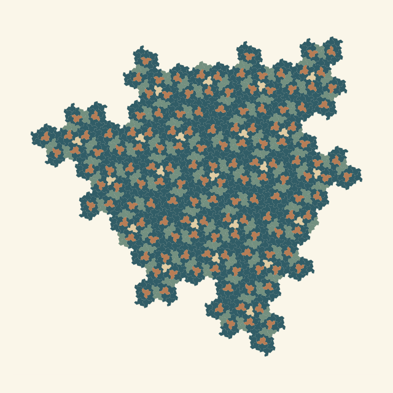

They are finite patches of documented aperiodic systems: they have no cell
to repeat by translation. Hat includes the reflections its system requires;
Spectre uses curved edges and a single chirality. Editable SVG reuses definitions;
expanded SVG, PNG/JPEG and DXF keep the result and its physical measurements.

[Editable Penrose](docs/examples/gallery-penrose.pattern.json) ·
[Hat with hierarchy](docs/examples/gallery-hat.pattern.json) ·
[Spectre by generation](docs/examples/gallery-spectre.pattern.json).

### Girih: stars and interlaced bands

In **Tiles → Girih**, enable the construction and choose a rosette, a rhombus
net or a tile from the catalogue. The catalogue contains a decagon, pentagon,
elongated hexagon, bowtie and 72° rhombus. **Join** adds a shape along a full
edge; it rejects collisions and keeps the last valid patch.

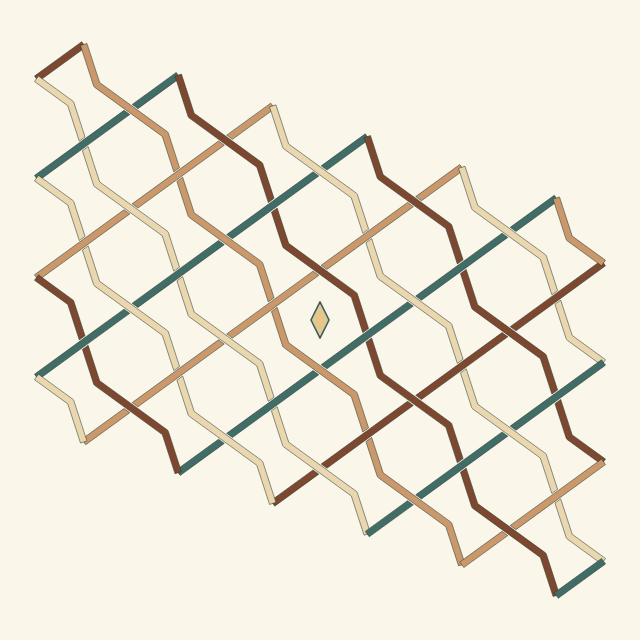

In **Bands**, adjust width, crossing separation and **Invert over/under**. The
lower pass is actually clipped: its gaps travel in SVG, raster and DXF.
Alternation connects the strands across shared edges; rotating or translating
the construction keeps its crossing relations.

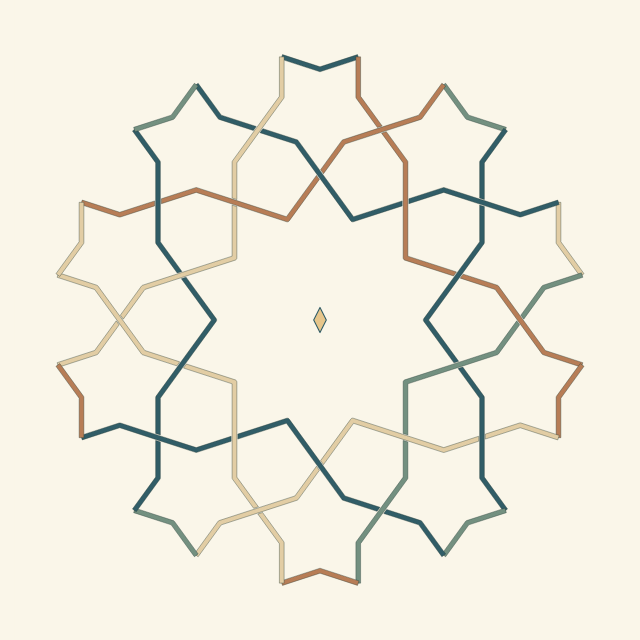

**Interlace motif strokes** also uses the axes you drew. **Edit source** keeps
the original vectors; curved axes are approximated to 0.02 mm before Placement.
If a cycle prevents alternation, the conflict is reported.
**Allow explicit alternation cuts** accepts exceptions and identifies them as
an artistic result. Uneven stretching or shear is also identified as artistic.
The constructions are finite patches with verified edges and contacts, without
claiming infinite coverage.

[Editable Girih rosette](docs/examples/gallery-girih-rosette.pattern.json) ·
[Editable interlaced net](docs/examples/gallery-girih-grid.pattern.json).

### See the drawing on a Poincaré disk

The **Visualise** button in the workspace opens a derived, non-editable view.
Choose the source set and a finite cell or window, configure **p/q**, centre,
orientation and detail, then press **Update view**. Combinations must satisfy
`(p−2)·(q−2)>4`. You can cancel the computation and try again.

**Back to source** returns to the flat editor with its nodes, strokes and Fill
intact. Reopening the view prepares the current source again. **Save study**
keeps drawing and configuration in JSON7; opening it regenerates the disk.
Older files migrate, and previous versions of the application reject this
format to avoid showing a projection as if it were flat.

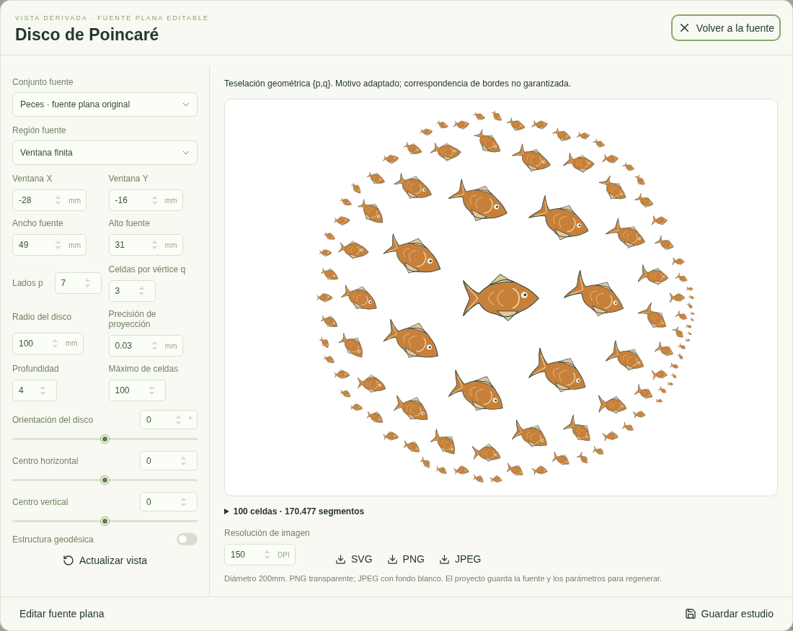

The tiling and its geodesics use hyperbolic construction; the motif is a
numeric adaptation. **Inscribed motif** keeps the adaptation inside each cell,
without guaranteeing edge correspondence. **Reflected triangles** adapts the
source to chambers with shared edges: their positions match (C0), although
the tangent may change and additional symmetries appear. The summary shows
detail limits and distinguishes the projection bound from the clipping and
contouring approximations. The view does not allow drawing, editing nodes or
applying Fill directly.

**SVG** keeps the physical diameter in millimetres. **PNG/JPEG** use the chosen
DPI; PNG allows transparency and JPEG uses a white background. These downloads
happen inside the derived view; the editor's exporter still exports the flat
work. DXF is not offered in this view.

The **Poincaré** category includes two studies with **reflected triangles**,
editable source and shared edges:

| Interlaced rosettes · {7,3} | Floral tiles · {5,4} |
| --- | --- |
| 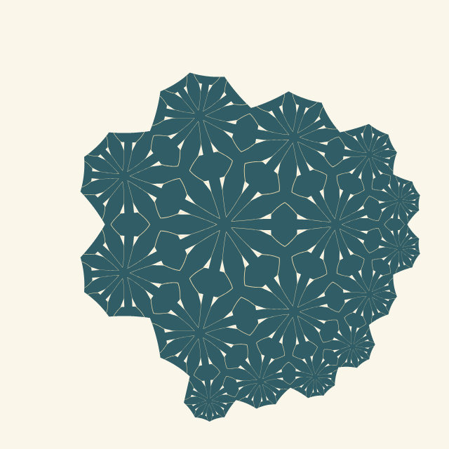 | 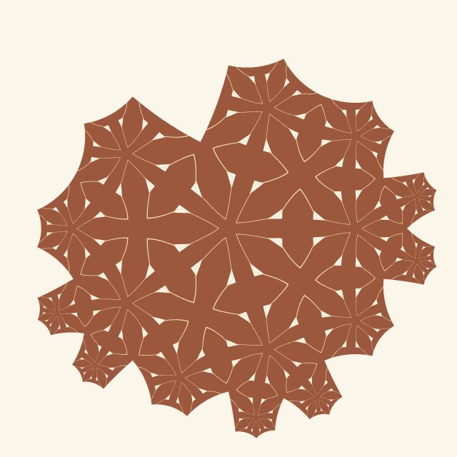 |
| [Editable JSON](docs/examples/gallery-poincare-seven.pattern.json) | [Editable JSON](docs/examples/gallery-poincare-five.pattern.json) |

The computation is finite and shows its limits. You can change the source and
increase detail. The studies use JSON7 and Poincaré component 2; component 1
migrates to inscribed motif. An older reader rejects component 2 explicitly.

Changing the cell size within the same group makes the motif follow the new
lattice while keeping the joins between copies. Its canonical nodes and tangents
remain editable. **Delete/Backspace** removes the objects selected with Shift;
**Undo** restores them. Replacing the study still asks to keep, save or discard
the work.

### Create an artistic disk

In **Visualise → Mode → Artistic disk**, a finite flat mosaic is
compressed towards a disk. **Radial compression**, centre and orientation change
the deformation; **Update view** applies the options. It is identified as
**ARTISTIC**: a visual composition, with no guarantee of keeping the flat
drawing's symmetries or edge correspondence.

It shares with Poincaré the return to the source, JSON7 saving, cancellation and
SVG/PNG/JPEG exports with physical measurements. You can switch modes while
keeping the source set, the crop and the measurements; each mode's own options
start at their defaults. The program regenerates the view when you return from
editing the drawing.

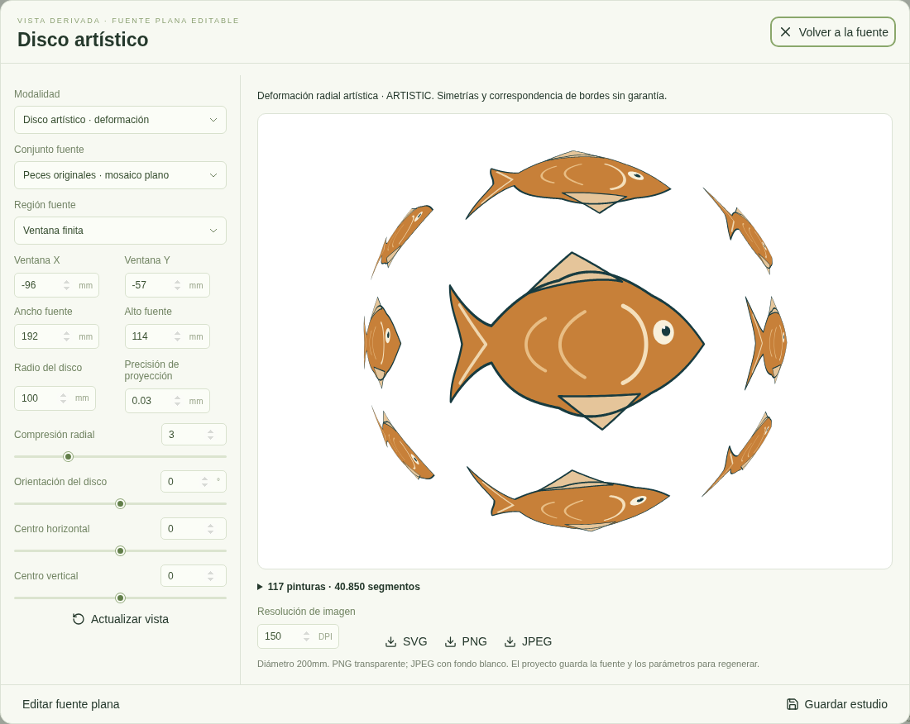

In **Artistic disks**, **Bird field** compresses a complete figurative mosaic.
Its flat source lets you keep editing the silhouettes and colours.

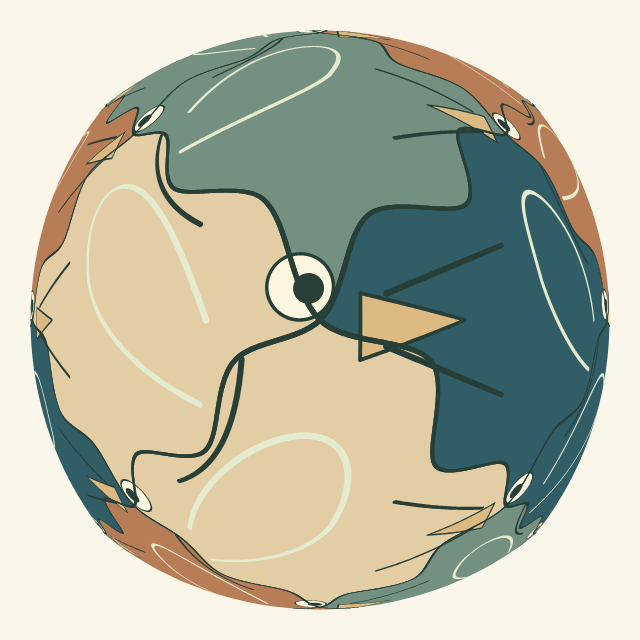

[Download the editable disk](docs/examples/gallery-artistic.pattern.json).

If a computation exceeds the budget, reduce the window or the compression, or
increase the projection tolerance. Cancelling keeps all the flat work.

### Explore a motif without losing the original drawing

In **File → Example gallery**, open **Blue birds · IH44** or draw your own motif. Enter **Symmetries → Explore all symmetries**. Hover p1, p4m and p6m and confirm an option. Thumbnails update with your motif; the selection, the tool and the sources stay available. [Download this example project](docs/examples/studio-symmetry.json).

Design and Pattern are emphasis views of the same document. **Split view** shows one editable cell, centred on the left, and the repetition on the right. Both share the zoom, including the wheel. Opening it fits the cell to the available space. **One cell** shows it on a single canvas, also from Pattern mode. The cell stays centred both here and in split; zoom works with buttons or Ctrl + wheel. To pan, go back to the repeated pattern. Patterns without a periodic cell show the full motif. Sets can inherit the main symmetry, have their own or stay free.


The reference cell also clips the selection outline, nodes and Fill preview. If you started drawing outside it, the full original is kept and the reference shows only the part belonging to that cell.


**Pure source** is under **Preferences → Advanced view**: it lets you edit the complete originals that cross several cells, or review fills and aperiodic patterns without clipping. The **100 %** scale equals the old **200 %**; document and export measurements keep their millimetres.


The expanded catalogue shows the 27 options with their mathematical names,
icons and a view of your motif. Filter by plane, frieze or radial; on mobile,
pages keep the full catalogue accessible. Stars store local favourites. Hover previews; click confirms and can be undone.

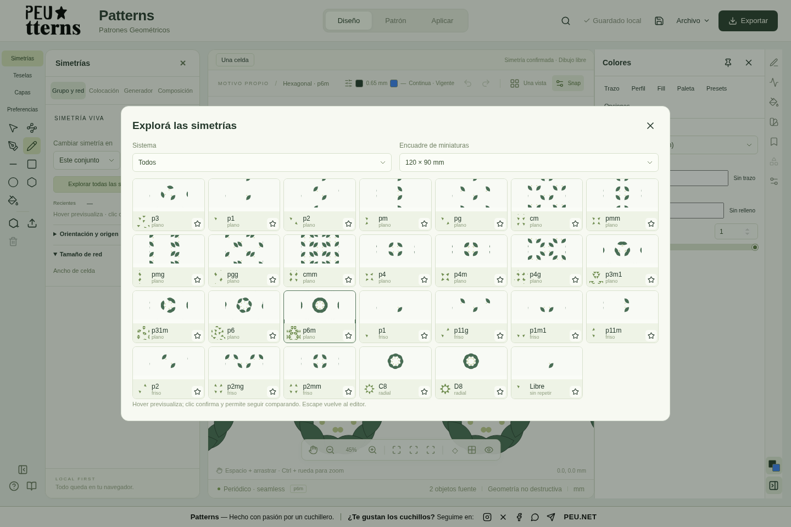

### Create and adjust a regular polygon

Press the **hexagon with +** in the toolbar. In the right panel,
**Object → Shape** shows sides, width, height, rotation, fill and stroke.
For example, choose eight sides and 42 × 42 mm; every value changes the real shape.
To move or reflect it use **Transform**; to convert it to paths,
**Nodes**. The operations keep undo/redo.

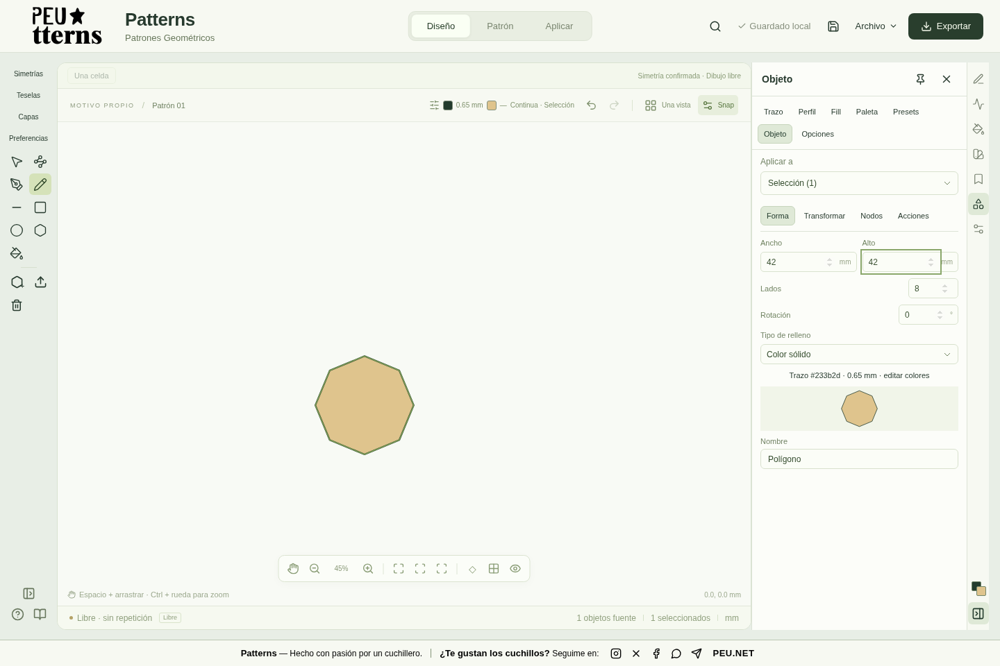

[Download the editable parametric polygon](docs/examples/parametric-polygon.json).

### Paint a region formed by several curves

Draw four segments or curves bounding an area and choose a fill colour. With **Fill region**, press inside it: an editable vector contour is created and the original strokes are kept. The image shows four independent curves and an inner circle: the hole stays empty and the fill propagates through the repetition.

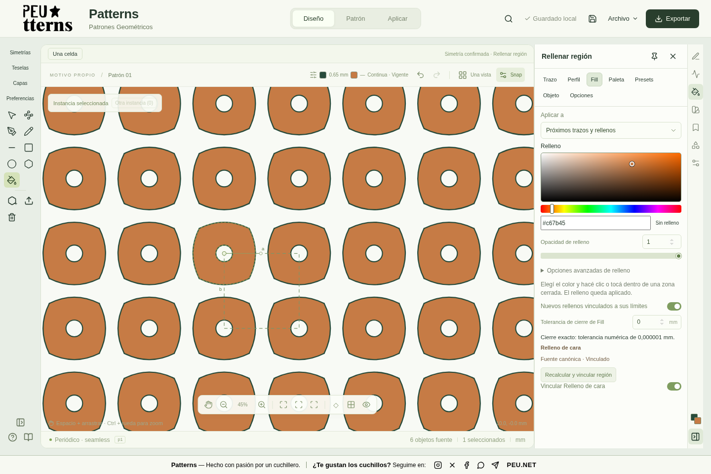

[Download the four-curves project](docs/examples/vector-fill.json) and open it from **File** to inspect the sources and the fill.

The fill can stay **linked** to its boundaries or become **fixed**. If a topology changes and the link is no longer valid, the last contour is kept and its state is shown; **Recalculate and link region** tries to recover an equivalent face. Pressing a painted area again recolours it without creating identical copies.

In patterns with symmetry, the fill is applied to the corresponding instances
of the same motif, including rotations and reflections. In **Penrose**, a finite
aperiodic region, you paint the chosen face: the colour sits above the
generator's backgrounds and below the original perimeters. It is kept when
leaving the area and when reloading, and is included in the export.


The canvas stays free of permanent curve notices. Progress and Cancel
computation appear only when an operation takes time; Another region is offered when
there is more than one option under the pointer.

By default, geometric closure is required within numeric epsilon. For small gaps, explicitly increase **Fill closure tolerance** in the right panel; this option does not modify the original strokes. Guides and structure mirrors do not count as material boundaries.

### Build tiles with curved edges

Open **Tiles → Shape** and choose a family. Enter **Edges** to edit nodes and **Tangents** to adjust the curves. Moving nodes and tangents changes the corresponding edges together to keep the interlock. Paint the inside with Fill and keep drawing on the copies.


[Download the curved-tiles project](docs/examples/curved-tiles.json) to explore its edges and its background separately.

There are squares, rectangles, parallelograms, equilateral triangles and regular hexagons. Structural vertices stay fixed and curves are limited to safe corridors. In triangles, half a curve is edited and its partner is derived by central symmetry. Arbitrary polygons are not offered as if they could tile.

The interior drawing and the tile outline are different entities. Fit to pattern frames the reference tile. To include the outline in SVG, DXF or raster, enable **Export tile outlines**. Shared edges are deduplicated. The legacy **Staggered motifs** generator and Penrose's finite aperiodic region remain available separately.

### Explore isohedral tiles

**Tiles → Explore catalogue IH1–IH93** opens a catalogue with IH search,
translation/rotation/reflection filters and views of the tile and its mosaic.
You can choose straight edges or an initial curve and keep editing nodes and
tangents. Motif details are kept when changing construction.

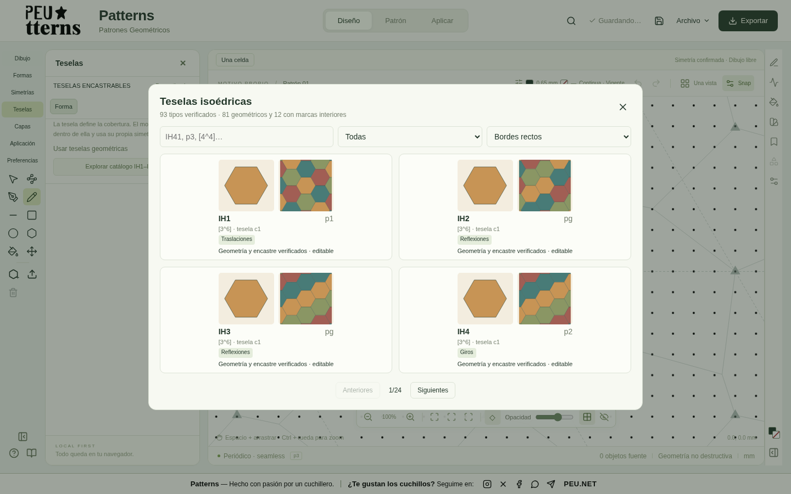

The **93 types are verified**: 81 are expressed through their geometry and 12
require interior marks. In the latter, edges are straight and the motif
repeats inside the tile as well to respect its group. **Shape** shows its
parameters by pages; **Edges** and **Tangents** control the related curves.
Adding a node keeps the curve. If an edit crosses the silhouette, inverts its
orientation or overlaps neighbours, the last valid version is kept. Edges that
must be mirror axes stay straight. Ctrl+K finds the catalogue.

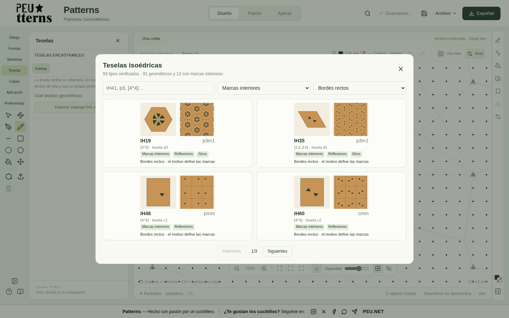

### Adjust appearance, save styles and compose

In the right panel, **Fill** offers HEX/alpha colour and fill opacity; **Stroke**, line colour, width, caps and joins; **Profile**, a width curve. The fill rule is in Fill's advanced options: it decides which parts are painted in crossing or holed contours. For normal use it can stay Even/odd. Palettes and presets have their own tabs. Save a named style to reuse its values without retroactively changing earlier objects. The compact indicator stays visible when the panel is closed; you can pin it open or let it auto-collapse when returning to the canvas.

**Layers** hides, locks and orders objects; **Object → Shape** names them. In **Apply**, create or import a closed perimeter and place the set on it. A frozen application keeps its effective symmetry even when the main one changes. The exporter lets you choose the active set or the visible composition; it only offers a common cell when its periodicity is verified.

The footer uses high-contrast black and bolds Patterns, ¿Te gustan los cuchillos? and PEU.NET at 13 px; «Seguime en:» keeps normal weight. It gathers the author's links in one line: **Patterns — Hecho
con pasión por un cuchillero. ¿Te gustan los cuchillos? Seguime en:**, with
Instagram, X, Facebook, WhatsApp, Telegram and PEU.NET. On narrow screens
it stacks to keep all links visible, without horizontal scrolling. Tab, favicon and home-screen icons use the updated files supplied in favicon_io.zip; the manifest keeps relative paths for root and subfolders. Its URLs include a revision so that icons the browser had cached are updated too.

When sharing the page, Open Graph and X/Twitter cards use the cover supplied by the author, with title, description and alt text. The image is published as `caratula.jpg`; it keeps the original JPEG of 1176 × 775, with no cropping or changes to the editor's logo. The canonical URL is `https://peu.net/pattern/`; the image links are absolute so networks can read them without running JavaScript.

## Saving and privacy

Transactional autosave uses IndexedDB and stores each project under its ID. Symmetry favourites are stored in this browser and recents last the session. These navigation preferences do not change the JSON or add undo. The library belongs to the browser and the HTTP origin (host and port). Another PC can review the application and its examples, but does not automatically see your browser's private projects. To exchange them, save and open JSON.

Explicit saving downloads a complete file and also tries to finish the local write. If the browser rejects IndexedDB, the application reports the error and the JSON is still available. A half-drawn perimeter does not replace the last valid autosave.

If there is already work, creating or opening another project, loading an example or recovering one from the library offers **Cancel**, **Save work and continue** or **Discard and continue**. Deleting a selection, application or instance is also confirmed. Cancel and Escape keep the work; cancelling the save dialog also cancels the pending operation. If local saving fails, the operation is blocked and you can retry.

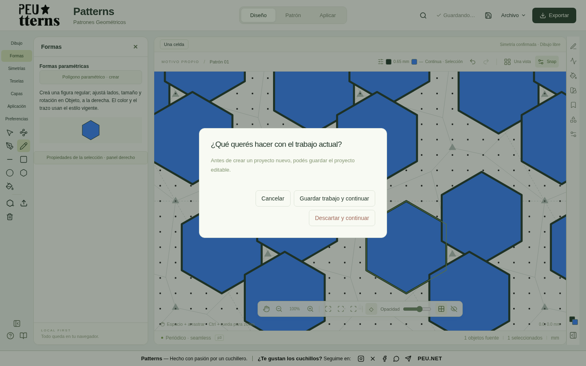

The File gallery gathers twenty-three editable examples and keeps eight quick accesses. Opening examples or creating projects keeps the previous ones in **This browser's library**. The visible logo uses the local `src/assets/icono.png` file supplied by the user.

## Scope and limits

Friezes repeat in one direction; rosettes and Penrose are finite constructions. An arbitrary oblique lattice is not presented as a seamless rectangular tile. Triangular groups do allow a rectangular supercell of height `sqrt(3)·width`.

Wave/Guilloché/Spirograph/Rosette generators produce deterministic sampled paths; their files contain exactly that vector geometry. DXF approximates Béziers with configurable tolerance and keeps mm; it does not keep fills or parametric editing.

SVG import supports paths, shapes, groups and compatible local references. It removes scripts, external resources, images, text, filters, gradients and other unsupported features, reporting their removal. Group opacity is applied per object and the possible difference in overlaps is warned about. Expanded SVG exports convert strokes to outlines by default to preserve their clipping and appearance; disabling it exports clipped centre lines.

Scenes are limited to 20,000 transformations and expansions to 150,000 paths; raster images are limited to 64 million pixels. Interactive targets are reference measurements, not guarantees for any complexity.

Fill limits each analysis to 1,200 entries/curves, 20,000 intersections, 40,000 half-edges and 2,000 faces. If repetitions exceed that budget in the full view, it automatically analyses the clicked region. It keeps curves, holes and sources; an already closed object can be recoloured directly even with more than 1,200 curves. A region whose local complexity exceeds those limits still requires simplifying its boundaries. Stroke contours have sample and subdivision budgets: if a combination exceeds the limits, the view offers to correct the style and the exporter reports the error. The exported result is never silently replaced by an image or a provisional axis. Physical tolerance is adjusted to affine transformations.

## Installation and running

Development requirements: Node.js 22.12 or later, npm; Python 3 for the LAN tools. Only npm and the included lockfile are used.

```bash
npm ci
npm run dev
```

Open `http://localhost:4173` or `http://<IP_LOCAL>:4173` from another PC. The Debian server needs no desktop or GPU. The client browser does the geometric work.

To keep and manage the local services without an open terminal:

```bash
npm run local:start
npm run local:status
npm run local:stop
```

`local:start` reuses its own active processes and rejects ports occupied by other services. PIDs and logs stay in `.runtime/`. To start the monitor for the first time outside the original Codex session, use `python3 scripts/local-services.py start --thread THREAD-UUID`.

### Review from the local network

- Live studio: `http://<IP_LOCAL>:4173`
- Progress, commits, quota and feedback: `http://<IP_LOCAL>:4174`

Replace `<IP_LOCAL>` with the address of the machine running the services. Check it locally with `hostname -I`; it may change with DHCP. Concrete addresses stay out of the repository. The development server is kept running so reviews appear as code is saved.

The progress panel is an independent development tool. It is not distributed as a product requirement and does not expose session files, credentials or browser projects.

### Build and deploy

```bash
npm run build
npm run serve:dist
```

Open `http://localhost:4180`. `dist/` contains only static files and licence notices. Copy its contents by FTP or to a conventional HTTP server. Do not upload `node_modules/`, `.runtime/`, `.git/` or Codex sessions.

The default relative path supports root and subdirectories. To pin a specific base:

```bash
BASE_PATH=/pattern/ npm run build
```

Copy `dist/` into the `/pattern/` subdirectory. No rewrite rules are needed: the application uses a single HTML document. HTTP over LAN works; it does not depend on service workers, HTTPS context, CDN, external fonts or an Internet connection. Files must be served over HTTP; opening the worker via `file://` is not promised.

### Publish and share creations (optional)

The editor works offline; publishing is a voluntary action from the **Share**
button in the header. It generates a permanent link with an Open Graph
thumbnail, WhatsApp/Telegram/Facebook/X buttons, native sharing and withdrawal
from the same device. The server only stores the compressed native JSON (GZIP),
minimal metadata and a small thumbnail: it requires PHP 8.1+ and write access to
a private directory, with no database. Configuration, quotas, backup and Open
Graph diagnostics: [docs/SHARE.md](docs/SHARE.md).

### Automatic FTP deployment with GitHub Actions

[Deploy FTP](.github/workflows/deploy-ftp.yml) runs with **every push to
main** and also manually from Actions: quick checks (`test:deploy`, `check`), a
build with relative paths and the FTP upload, all in about 2 minutes. In
parallel, [QA gate](.github/workflows/qa-gate.yml) runs the full gate
(`qa:full`, E2E and independent parsers) without blocking publication; its
evidence is saved as artefacts and failures arrive by email. FTP credentials are
only given to the deployment job.

Configure these four **Repository secrets** in Settings → Secrets and
variables → Actions:

| Secret | Content |
| --- | --- |
| `FTP_HOST` | FTP host, without the `ftp://` prefix |
| `FTP_USERNAME` | FTP account user |
| `FTP_PASSWORD` | FTP password |
| `FTP_FOLDER` | Application folder inside `public_html` |

With `FTP_FOLDER=pattern`, the destination is **`public_html/pattern/`**. No
trailing slash is needed: the workflow adds it. It also accepts
`pattern/` or `public_html/pattern/` without duplicating the prefix. The path is
relative to the FTP account's home folder, which must have access to
`public_html`. The build uses `./` as base, regardless of that folder's name.

Uploads run one at a time; a new push does not interrupt an active transfer. Application files are synchronised through the action's state, without emptying the whole folder or uploading the source code, the monitor, `.runtime/` or the credentials. The configured protocol is FTP, port 21. To see the result of a publication, open its run in **Actions**.

First verified publication: [successful GitHub Actions run](https://github.com/pablopeu/pattern/actions/runs/44744523772).

Local validation of the destination normalisation: `npm run test:deploy`.
Reference: [FTP Deploy Action settings](https://github.com/SamKirkland/FTP-Deploy-Action#settings).

## Development and work tracking

### Verification

The [QA runner](docs/QA.md) executes suites with a compact summary and complete
evidence in `.runtime/qa/`: `npm run qa:fast` during development,
`npm run qa:integration` when integrating and `npm run qa:full` when closing
phases or releases. It does not repeat approved results for equivalent inputs.
`qa:status` and `qa:failures` show a summary or the localised failures.


```bash
npm run check
npm run test:monitor
npx playwright install chromium
npm run test:e2e
npm run benchmark
```

v3.0 progress: **1136 unit/TypeScript tests**, **200 E2E flows** and **16 static tests** verified. Phases 0–3 include 93 IH, composition, Hat/Spectre and Girih. Phase 4 already has the Poincaré geometric view and artistic disk, finite source, JSON7 and SVG/PNG/JPEG export; adaptation with shared edges is already available; colour by class and other criteria remain pending. Detailed state: [current report](docs/STATUS.md) and [v3.0 acceptance](docs/ACCEPTANCE_V30.md).

Historical v2.3 baseline: **203 unit tests, 94 E2E flows, 9 monitor tests and 6 static tests**. The 75 earlier journeys are kept. Root/subdirectory builds and independent export validation are correct.

The benchmark needs the development server. Static tests and independent file validation are explained in [TESTING.md](docs/TESTING.md). Earlier results: [docs/ACCEPTANCE.md](docs/ACCEPTANCE.md). UX audit: [docs/ACCEPTANCE_V23.md](docs/ACCEPTANCE_V23.md) and the [feature inventory](docs/UX_V23_INVENTORY.md).

Navigation screenshots are regenerated with `node scripts/capture-navigation-feedback.mjs` and the confirmation with `node scripts/capture-work-protection.mjs`. To regenerate the five screenshots and the four basic JSON files with the local server running: `node scripts/capture-readme.mjs`. An isolated browser is used; the user's browser projects are not modified.

### Quota and feedback monitor

```bash
npm run monitor
python3 scripts/work_monitor.py --status
```

It reads only the `rate_limits` events of the local thread identified by `CODEX_THREAD_ID`, `--thread` or the ID stored in `.runtime/thread-id`. It publishes percentages, observation and reset timestamps, local Git history and documentation.

With 10 % or less available in the primary 5-hour window, it asks to close the increment and stores a timer. After the real primary reset +60 seconds it asks to resume **the same thread** through `codex queue --resume`. The secondary/weekly quota only sends a notice: Pablo decides whether to use a banked reset; it does not pause work or delay the timer to the weekly reset. It does not change limits or invent a new quota when the clock expires. The agent checks the telemetry on continuing. Resuming needs the machine and the local Codex daemon to stay available; any failure is recorded in `.runtime/monitor-events.jsonl`.

The monitor shows feedback first and then documented progress, both newest to oldest. Commits keep their order and stay at the end.

Panel feedback is stored in `.runtime/feedback.jsonl` and sent to this conversation through a queue independent of the quota, even while the agent is working or waiting for the reset. The dashboard distinguishes **Pending delivery**, **In conversation** and **Reviewed**. Failures are retried; the local delivery record prevents normal resends after a restart. "In conversation" confirms queuing, not that the agent has already read it. The `.runtime/STOP` file disables the monitor cycle; `.runtime/PROJECT_COMPLETE` indicates that the PRD was verified and cancels pending resumptions. Review processes stay on the LAN. Authorised code remote: [pablopeu/pattern](https://github.com/pablopeu/pattern), branch `main`.

### Technical documentation

- [ARCHITECTURE.md](docs/ARCHITECTURE.md): modules, data flow and rendering.
- [GEOMETRY.md](docs/GEOMETRY.md): groups, lattices, precision and mathematical limits.
- [PROJECT_FORMAT.md](docs/PROJECT_FORMAT.md): format, recovery and migrations.
- [TESTING.md](docs/TESTING.md): tests, benchmark and external validators.
- [THIRD_PARTY_NOTICES.md](docs/THIRD_PARTY_NOTICES.md): dependencies and references inspected.
- [docs/PROGRESS.md](docs/PROGRESS.md): progress and correction log.

---

# Español

[English](#pattern-studio-2d)

Estudio vectorial para dibujar motivos, explorar simetrías y construir patrones y teselas editables. El dibujo se repite mientras trabajás: las copias comparten una fuente canónica, de modo que editar una actualiza el patrón completo.

Funciona en el navegador, procesa toda la geometría localmente y se puede desplegar como archivos estáticos. No requiere cuentas, APIs ni conexión a servicios externos.


## Qué podés crear

- Motivos a mano alzada, líneas, curvas Bézier y formas cerradas, con medidas físicas en milímetros.
- Patrones con los 17 grupos del plano, siete frisos y simetrías radiales. Las miniaturas usan tu dibujo para mostrar qué hace cada opción.
- Trazos continuos, punteados o personalizados; perfiles de ancho variable, colores, opacidades, paletas y estilos guardados.
- Rellenos vectoriales de objetos cerrados o de regiones delimitadas por varios trazos, incluso desde copias reflejadas o rotadas.
- Teselas encastrables con bordes curvos y patrones aplicados sobre perímetros con agujeros.
- Composiciones recursivas y espirales con un motivo editable, paletas por nivel y recetas guardadas.
- Archivos JSON editables y exportaciones SVG, PNG, JPEG y DXF.

## Primeros pasos

1. Abrí **Archivo → Nuevo proyecto**. El estudio empieza en **P3**, con zoom **100%**, origen centrado, estructura visible al **50%** y **Dibujo libre** activo. Arrastrá para dibujar; también podés elegir línea, pluma o figuras.
2. Elegí color y grosor en **Trazo** (icono de lápiz; deslizador de **0 a 2 mm**, con entrada numérica para otros grosores), o el color de relleno en **Fill**. **Aplicar a** permite editar los objetos seleccionados o lo que vas a dibujar a continuación.
3. Abrí **Simetrías → Grupo y red** en la barra izquierda. Pasá por las miniaturas de **Simetría viva** para explorar. Clic, Enter o Espacio confirman el grupo y conservan tus fuentes. Podés seguir dibujando desde cualquier copia.
4. Elegí **Rellenar región** y hacé clic dentro de una zona cerrada. El color queda aplicado al retirar el puntero; en una pantalla táctil alcanza un toque. Deshacer revierte la operación. No hace falta un botón de confirmación.
5. Usá **Archivo → Guardar archivo JSON** para continuar editándolo. Al guardar se pide el nombre; si no lo elegiste, se propone **Estudio-AA-MM-DD-HH-MM**, con tu fecha y hora local. También podés editarlo en Archivo. Usá **Exportar** para obtener el resultado final.

P3 encabeza el catálogo y **Libre** queda al final; el resto conserva su orden.
Los proyectos recuperados mantienen su simetría y preferencias guardadas. Al
arrancar, la herramienta activa es Dibujo libre. En móvil, los paneles empiezan
plegados para dejar libre el lienzo.


El botón del **cuadrado dividido en cuatro** muestra u oculta la grilla de puntos
negros cada **5 mm**. Es una referencia visual, independiente de la estructura
de simetría; **Snap** controla por separado el ajuste a grilla y nodos.

La pluma termina con Enter, se cierra con Shift+Enter o un clic sobre el primer nodo y se cancela con Esc. Espacio permite arrastrar la vista; Ctrl + rueda controla el zoom.

Con **Snap** activo, al dibujar o arrastrar un nodo éste se atrae al nodo más
cercano: aparece un círculo verde y las posiciones coinciden exactamente al
soltar. Funciona también sobre copias transformadas y permite acercar ambos
extremos de un mismo trazado. Ajustá **Preferencias → Distancia de atracción a
nodos** entre **1 y 40 px** (inicialmente **8 px**); la distancia visual se mantiene
al cambiar el zoom. El ajuste de nodos tiene prioridad sobre la grilla.
**Snap** en la barra controla la atracción entre nodos. **Preferencias → Ajustar
a grilla** es independiente: podés desactivarlo y mantener la atracción activa.
Los extremos snapeados guardan una unión permanente: al arrastrar uno acompañan
los demás trazos unidos, incluso después de guardar y abrir el archivo. Unir el
otro extremo conserva el primero. Alt al iniciar el arrastre permite separar
un extremo; los objetos bloqueados no se mueven.

**Clic derecho** termina la Bézier que estás dibujando. Fuera de un trazado activo,
abre un menú sobre la curva para **Añadir nodo aquí** sin cambiar su forma; sobre
un nodo permite **Eliminar nodo** o **Separar snap**. Estas acciones tienen deshacer.

Para rellenar áreas contiguas, dibujá su borde compartido una sola vez y completá
los otros lados. **Rellenar región** detecta cada área por separado aunque sus
límites sean trazos independientes; no hace falta fusionarlos en un único objeto.
La **Tolerancia de cierre de Fill**, en el panel derecho de Fill, permite salvar
pequeños huecos al calcular el relleno, sin mover los nodos originales. Es un
ajuste distinto de la distancia de atracción.
Las curvas Bézier abiertas se dibujan sin relleno implícito. El color elegido se
conserva para cuando se cierre el trazado; si se cierra con otros trazos, usá Fill
sobre el área resultante.

**Desplazar vista** está junto a los controles de zoom del área de trabajo.
En **Una celda**, la referencia permanece centrada y se puede acercar o alejar;
**Ajustar contenido** y **Restablecer vista** vuelven a mostrarla completa.
En móvil, el footer apila texto y enlaces sociales para mantenerlos visibles
sin desplazamiento horizontal.

Las preferencias de trabajo —Snap, grilla, radio de atracción, unidades,
vínculos/tolerancia de Fill y comportamiento de los paneles— se guardan en el
navegador y continúan entre proyectos. **Nuevo proyecto** restablece la geometría,
el encuadre y la herramienta acordados, conservando esos ajustes. Los fondos de
archivos y ejemplos se respetan; los estudios nuevos usan tu último fondo elegido.

## Encontrar herramientas y opciones

La barra izquierda abre un contexto a la vez. Las herramientas de dibujo
siguen disponibles directamente; los iconos muestran su nombre y atajo al
pasar el cursor. Cada panel se puede plegar. Las pestañas se recuerdan
durante la sesión y cambiar de contexto conserva el documento y la selección.

| Contexto | Qué contiene |
| --- | --- |
| Simetrías | Explorador, recientes/favoritos, red, colocación, generadores y composición |
| Teselas | Familias visuales Encastre, Aperiódicas y Girih; catálogo IH y parámetros contextuales |
| Capas | Objetos del conjunto, visibilidad, bloqueo y administración de conjuntos |
| Preferencias | Guías, Snap, unidades y fondo |

Dibujo y Formas no tienen otra entrada: sus herramientas actúan directamente y
sus parámetros están a la derecha. El hexágono con **+** crea el polígono regular.
**Aplicar**, arriba, abre directamente perímetros y colocación, sin otra entrada
lateral. **Diseño** permite editar y dividir la vista; **Patrón** muestra una vista
única completa y también permite editar. Los tres usan el mismo documento.

En Simetrías, **Cambiar simetría en → Este conjunto** modifica sólo el activo;
**Compartida** modifica la configuración seguida por los conjuntos que la usan.
**Repetición de este conjunto** elige Propia, Compartida o Sin repetir. La estrella
junto al explorador marca la actual como favorita. **Orientación y origen** reúne
los deslizadores; su ajuste fino en P3 es provisionalmente±6°, con entrada numérica
para otros valores. Al mover o girar la red, las uniones entre copias se conservan.


**Capas → Objetos** lista trazos, figuras y rellenos; el candado impide seleccionarlos,
editarlos o borrarlos por accidente y permite desbloquearlos. **Conjuntos** agrupa
muchos objetos: otra región cerrada sigue en el mismo conjunto hasta que elijas
**Nuevo conjunto**. El activo indica dónde agregás los siguientes trazos. La
[guía del espacio de trabajo](docs/WORKSPACE_GUIDE.md) explica estos controles y modos.

A la derecha están **Trazo, Perfil, Fill, Paleta, Presets, Objeto y Opciones**.
Fill comienza con azul y muestra el selector de color abierto; el campo HEX queda
debajo como alternativa. Elegir un color de relleno activa **Rellenar región**.
Los rellenos derivados se pintan debajo de los trazos que delimitan cada área.
**Fill** muestra directamente su color y opacidad; **Trazo** reúne color y
propiedades de línea. Los dos cuadrados de color al pie de la barra abren un
acceso conjunto a trazo y relleno, sin una pestaña Colores separada. Al seleccionar un objeto aparecen sus propiedades; sin selección,
se edita el estilo vigente. **Objeto** separa forma, transformación, nodos y
acciones geométricas. En ventanas estrechas los paneles funcionan como overlays
temporales y se alternan para dejar disponible el lienzo. Una barra de iconos
permanece en el borde derecho: cada icono abre directamente su sección; **Objeto**
se habilita al seleccionar una figura. El botón inferior pliega/despliega el
panel y recuerda la pestaña. Al abrir **Archivo** o **Exportar**, el panel derecho
se pliega primero, incluso si estaba fijado, para dejar libre el menú. Volver a pulsar **Rellenar región**, aunque ya esté
activo, vuelve a abrir sus controles; también funciona con **F**.

**Ctrl+K** abre la búsqueda: probá «polígono», «rellenar», «simetría p6m»,
«teselas», «grosor» o «exportar SVG». Flechas y Enter eligen una acción;
Escape cierra el buscador. La búsqueda usa las mismas acciones del editor.

**Referencias**, junto al botón de ayuda de atajos, abre un modal con scroll y
enlaces a los repositorios consultados y las bibliotecas del estudio.

## Ejemplos de uso

### Peces, aves, recursión y espirales

Abrí **Archivo → Galería de ejemplos**: hay **23 estudios**, con
búsqueda, categorías y miniaturas del resultado real. Las tarjetas se paginan
según el tamaño de pantalla; el diálogo entra completo sin barras de scroll.


**Peces · Límite cuadrado de geometría funcional** usa los datos vectoriales
acreditados de *Programming with Escher*. Una fuente y412 instancias forman la
construcción clásica. En **Simetrías → Composición**, la profundidad0–5 cambia
el detalle; **Editar motivo fuente** permite modificar el pez. Los datos y su
licencia GPL3 se conservan en el repositorio y en los avisos; JSON y SVG llevan
su procedencia. No se incluye una imagen del grabado.


[Descargar el estudio editable](docs/examples/v3-escher-square.pattern.json) ·
[Fuente y atribución](https://github.com/mapio/programming-with-escher).

**Peces · Roseta autosimilar** permite probar giro, escala, brazos y paleta.
Es un ensayo artístico finito: los espacios son intencionales. Para encastres
continuos, elegí la categoría **Figurativas** o los ejemplos de Poincaré con
bordes compartidos.


[Descargar la roseta](docs/examples/gallery-spiral.pattern.json).

Cada familia y receta recuerda sus parámetros y colores. Podés alternar recursiva,
espiral y recetas, volver, y recuperar el resultado anterior, también al reabrir
el JSON. La fuente y los rellenos de tesela se conservan; no se sustituyen al
explorar otras disposiciones.

También podés componer tu propio dibujo: **Simetrías → Composición → Recursiva o
Espiral**. Recursiva ofrece geometría funcional, anillos, cuadrantes y ramificación; Espiral ofrece
repetición discreta, logarítmica, roseta y convergencia hacia un punto fijo.
**Ajustar composición** encuadra todo el resultado. Ctrl+K encuentra estas funciones.

Son composiciones **finitas**, con transformaciones afines verificadas; no se
certifican como teselados sin huecos ni como geometría hiperbólica. Al activarlas,
la simetría y las teselas previas quedan guardadas; al desactivarlas vuelven a
usarse. El fondo de una tesela queda asociado a esa cobertura. El límite de detalle
y el presupuesto evitan una recursión ilimitada. SVG, PNG, JPEG y DXF usan la receta
guardada y medidas físicas independientes del zoom; DXF transporta contornos,
sin colores de relleno. La procedencia de cada ejemplo viaja en el JSON.

### Figuras que encastran: peces, aves y reptiles

En la categoría **Figurativas** hay peces **IH43**, aves **IH44**, reptiles
estilizados **IH1** y un ornamento de cuatro giros **IH63**. Son dibujos propios,
inspirados en la idea de división regular del plano; no son calcos de Escher.
Cada ejemplo incluye su clasificación y referencias.


Abrí **Peces de jade → Teselas → Bordes** y arrastrá un nodo: el borde
relacionado y la silueta se actualizan juntos. Ojos, aletas, plumas y escamas
siguen siendo objetos independientes. Las deformaciones inválidas conservan la
última forma válida. En **Simetrías → Composición**, una receta recursiva o espiral
puede usar la figura con su silueta enlazada, sin duplicar sus fuentes. El
ornamento IH63 muestra además sus marcas interiores de giro.

En **Teselas → Forma → Colores**, activá **Alternar colores de tesela** y elegí
una paleta de dos a seis colores. Fill sobre el fondo de una figura cambia su
clase de color en todo el mosaico, sin duplicar el dibujo. Los ejemplos ya
incluyen paletas. La celda repetible y su exportación incluyen el período de
color completo; puede ser mayor que la celda geométrica. La alternancia conserva
el encastre, aunque puede reducir las simetrías del resultado coloreado.


[Descargar peces IH43](docs/examples/gallery-fish.pattern.json) ·
[Descargar aves IH44](docs/examples/gallery-bird.pattern.json) ·
[Descargar reptiles IH1](docs/examples/gallery-reptile.pattern.json) ·
[Descargar ornamento IH63](docs/examples/gallery-abstract.pattern.json).

### Parches aperiódicos: Penrose, Hat y Spectre

En **Teselas**, cambiá la categoría **Encastre → Aperiódicas**. Elegí la
construcción, su semilla, sustituciones, tamaño y giro. **Color** permite pintar
por tipo, por grupo de una generación o por reflexión en Hat. **Jerarquía**
muestra los marcos de sustitución; son ayudas de lectura, no bordes de teselas.


**Editar motivo fuente** abre una sola tesela de referencia. Dibujá sus detalles
y usá **Ver parche completo** para verlos propagados. Las copias usan matrices;
el archivo conserva una sola fuente. **Volver al motivo guardado** recupera el
dibujo sin convertir miles de copias en objetos. Fill persiste bajo los contornos.


Son parches finitos de sistemas aperiódicos documentados: no tienen una celda
para repetir por traslación. Hat incluye las reflexiones que requiere su sistema;
Spectre usa bordes curvos y una sola mano. SVG editable reutiliza definiciones;
SVG expandido, PNG/JPEG y DXF conservan el resultado y sus medidas físicas.

[Penrose editable](docs/examples/gallery-penrose.pattern.json) ·
[Hat con jerarquía](docs/examples/gallery-hat.pattern.json) ·
[Spectre por generación](docs/examples/gallery-spectre.pattern.json).

### Girih: estrellas y bandas entrelazadas

En **Teselas → Girih**, activá la construcción y elegí una roseta, una red de
rombos o una tesela del catálogo. El catálogo contiene decágono, pentágono,
hexágono alargado, corbatín y rombo72°. **Unir** permite agregar una forma por
un borde completo; rechaza colisiones y conserva el último parche válido.


En **Bandas**, ajustá el ancho, la separación de los cruces y **Invertir
arriba/abajo**. El paso inferior se recorta de verdad: sus huecos viajan en SVG,
raster y DXF. La alternancia conecta las hebras a través de bordes compartidos;
girar o trasladar la construcción conserva sus relaciones de cruce.


**Entrelazar trazos del motivo** también usa los ejes que dibujaste. **Editar
fuente** conserva los vectores originales; los ejes curvos se aproximan a0,02mm
antes de Colocación. Si un ciclo impide alternar, se informa el conflicto.
**Permitir cortes explícitos de alternancia** acepta las excepciones y las
identifica como resultado artístico. Un estiramiento desigual o una cizalla
se identifica también como artístico. Las construcciones son parches finitos,
con bordes y contactos verificados, sin afirmar cobertura infinita.

[Roseta Girih editable](docs/examples/gallery-girih-rosette.pattern.json) ·
[Red entrelazada editable](docs/examples/gallery-girih-grid.pattern.json).

### Ver el dibujo en un disco de Poincaré

El botón **Visualizar** del área de trabajo abre una vista derivada no editable.
Elegí el conjunto fuente y una celda o ventana finita, configurá **p/q**, centro,
orientación y detalle, y pulsá **Actualizar vista**. Las combinaciones deben
cumplir `(p−2)·(q−2)>4`. Podés cancelar el cálculo y volver a intentarlo.

**Volver a la fuente** devuelve al editor plano con sus nodos, trazos y Fill
intactos. Al reabrir la vista se prepara otra vez la fuente actual. **Guardar
estudio** conserva dibujo y configuración en JSON7; al abrirlo se regenera el
disco. Los archivos anteriores migran y las versiones anteriores de la aplicación
rechazan este formato para evitar mostrar una proyección como si fuera plana.


La teselación y sus geodésicas tienen construcción hiperbólica; el motivo es una
adaptación numérica. **Motivo inscrito** conserva la adaptación dentro de cada
celda, sin garantizar correspondencia de bordes. **Triángulos reflejados** adapta
la fuente a cámaras con bordes compartidos: sus posiciones coinciden (C0), aunque
la tangente puede cambiar y aparecen simetrías adicionales. El resumen muestra límites de detalle y distingue la cota de proyección
de las aproximaciones del recorte y contorneado. La vista no permite dibujar,
editar nodos ni aplicar Fill directamente.

**SVG** conserva el diámetro físico en milímetros. **PNG/JPEG** usan el DPI
elegido; PNG permite transparencia y JPEG usa fondo blanco. Estas descargas se
hacen dentro de la vista derivada; el exportador del editor sigue exportando el
trabajo plano. En esta vista no se ofrece DXF.

La categoría **Poincaré** incluye dos estudios con **Triángulos reflejados**,
fuente editable y bordes compartidos:

| Rosetas enlazadas · {7,3} | Teselas florales · {5,4} |
| --- | --- |
|  |  |
| [JSON editable](docs/examples/gallery-poincare-seven.pattern.json) | [JSON editable](docs/examples/gallery-poincare-five.pattern.json) |

El cálculo es finito y muestra sus límites. Podés cambiar la fuente y aumentar
el detalle. Los estudios usan JSON7 y Poincaré componente2; componente1 migra a
motivo inscrito. Un lector anterior rechaza componente2 explícitamente.

Al cambiar el tamaño de celda dentro del mismo grupo, el motivo acompaña la
nueva red y conserva las uniones entre copias. Sus nodos y tangentes canónicos
siguen editables. **Delete/Backspace** elimina los objetos seleccionados con
Shift; **Deshacer** los recupera. Reemplazar el estudio sigue pidiendo conservar,
guardar o descartar el trabajo.

### Crear un disco artístico

En **Visualizar → Modalidad → Disco artístico**, un mosaico plano finito se
comprime hacia un disco. **Compresión radial**, centro y orientación cambian
la deformación; **Actualizar vista** aplica las opciones. Se identifica como
**ARTISTIC**: es una composición visual, sin garantía de conservar las simetrías
o la correspondencia de bordes del dibujo plano.

Comparte con Poincaré el regreso a la fuente, guardado JSON7, cancelación y
exportaciones SVG/PNG/JPEG con medidas físicas. Podés cambiar de modalidad
conservando el conjunto fuente, el recorte y las medidas; las opciones propias
de cada modalidad comienzan con sus valores predeterminados. El programa
regenera la vista al volver de editar el dibujo.


En **Discos artísticos**, **Campo de aves** comprime un mosaico figurativo
completo. Su fuente plana permite seguir editando las siluetas y los colores.


[Descargar el disco editable](docs/examples/gallery-artistic.pattern.json).

Si un cálculo supera el presupuesto, reducí la ventana o la compresión, o aumentá
la tolerancia de proyección. Cancelar conserva todo el trabajo plano.

### Explorar un motivo sin perder el dibujo original

En **Archivo → Galería de ejemplos**, abrí **Aves azules · IH44** o dibujá tu propio motivo. Entrá en **Simetrías → Explorar todas las simetrías**. Pasá por p1, p4m y p6m y confirmá una opción. Las miniaturas se actualizan con tu motivo; la selección, la herramienta y las fuentes siguen disponibles. [Descargar este proyecto de ejemplo](docs/examples/studio-symmetry.json).

Diseño y Patrón son vistas de énfasis del mismo documento. **Vista dividida** muestra una celda editable, centrada a la izquierda, y la repetición a la derecha. Ambas comparten el zoom, incluso con la rueda. Al abrirla se ajusta la celda al espacio disponible. **Una celda** permite verla en un solo lienzo, también desde el modo Patrón. La celda queda centrada tanto aquí como en split; el zoom funciona con botones o Ctrl + rueda. Para desplazarte, volvé al patrón repetido. En patrones sin celda periódica se muestra el motivo completo. Los conjuntos pueden heredar la simetría principal, tener una propia o permanecer libres.


La celda de referencia recorta también el contorno de selección, los nodos y la previsualización de Fill. Si empezaste a dibujar fuera de ella, el original completo se conserva y la referencia muestra sólo la parte que corresponde a esa celda.


**Fuente pura** queda en **Preferencias → Vista avanzada**: permite editar los originales completos que cruzan varias celdas o revisar rellenos y patrones aperiódicos sin recorte. La escala **100%** equivale al antiguo **200%**; las medidas del documento y de las exportaciones conservan sus milímetros.


El catálogo ampliado muestra las 27 opciones con sus nombres matemáticos,
iconos y una vista de tu motivo. Filtrá por plano, friso o radial; en móvil,
las páginas mantienen accesible el catálogo completo. Las estrellas guardan
favoritos locales. Hover previsualiza; clic confirma y se puede deshacer.


### Crear y ajustar un polígono regular

Pulsá el **hexágono con +** de la barra de herramientas. En el panel derecho,
**Objeto → Forma** muestra lados, ancho, alto, rotación, relleno y trazo.
Por ejemplo, elegí ocho lados y 42 × 42 mm; cada valor cambia la figura real.
Para moverla o reflejarla usá **Transformar**; para convertirla a paths,
**Nodos**. Las operaciones conservan undo/redo.


[Descargar el polígono paramétrico editable](docs/examples/parametric-polygon.json).

### Pintar una región formada por varias curvas

Dibujá cuatro segmentos o curvas que delimiten un área y elegí un color de relleno. Con **Rellenar región**, pulsá su interior: se crea un contorno vectorial editable y se conservan los trazos originales. La imagen muestra cuatro curvas independientes y un círculo interior: el hueco permanece vacío y el relleno se propaga por la repetición.


[Descargar el proyecto de las cuatro curvas](docs/examples/vector-fill.json) y abrirlo desde **Archivo** para inspeccionar las fuentes y el relleno.

El relleno puede quedar **vinculado** a sus límites o **fijo**. Si cambia una topología y el vínculo deja de ser válido, se conserva el último contorno y se muestra su estado; **Recalcular y vincular región** intenta recuperar una cara equivalente. Volver a pulsar una zona pintada permite recolorearla sin crear copias idénticas.

En patrones con simetría, el relleno se aplica a las instancias correspondientes
del mismo motivo, incluidas rotaciones y reflexiones. En **Penrose**, que es una
región aperiódica finita, pintás la cara elegida: el color queda sobre los fondos
del generador y debajo de los perímetros originales. Se conserva al salir del
área y al recargar, y se incluye en la exportación.


El lienzo queda libre de avisos permanentes de curvas. El progreso y Cancelar
cálculo aparecen sólo cuando una operación tarda; Otra región se ofrece cuando
hay más de una opción bajo el puntero.

Por defecto se exige cierre geométrico dentro del epsilon numérico. Para pequeños huecos, aumentá explícitamente **Tolerancia de cierre de Fill** en el panel derecho; esta opción no modifica los trazos originales. Las guías y los espejos de estructura no cuentan como límites materiales.

### Construir teselas con bordes curvos

Abrí **Teselas → Forma** y elegí una familia. Entrá en **Bordes** para editar nodos y en **Tangentes** para ajustar las curvas. Al mover nodos y tangentes, los bordes correspondientes cambian juntos para conservar el encastre. Pintá el interior con Fill y seguí dibujando sobre las copias.


[Descargar el proyecto de teselas curvas](docs/examples/curved-tiles.json) para explorar sus bordes y su fondo por separado.

Hay cuadrados, rectángulos, paralelogramos, triángulos equiláteros y hexágonos regulares. Los vértices estructurales permanecen fijos y las curvas se limitan a corredores seguros. En triángulos se edita media curva y se deriva su pareja mediante simetría central. No se ofrecen polígonos arbitrarios como si pudieran teselar.

El dibujo interior y el contorno de tesela son entidades diferentes. Ajustar al patrón encuadra la tesela de referencia. Para incluir el contorno en SVG, DXF o raster, activá **Exportar contornos de teselas**. Las aristas compartidas se deduplican. El generador legado **Motivos escalonados** y la región aperiódica finita de Penrose siguen disponibles por separado.

### Explorar teselas isoédricas

**Teselas → Explorar catálogo IH1–IH93** abre un catálogo con búsqueda por IH,
filtros de traslaciones/giros/reflexiones y vistas de la tesela y su mosaico.
Podés elegir bordes rectos o una curva inicial y seguir editando nodos y
tangentes. Los detalles del motivo se conservan al cambiar de construcción.


Los **93 tipos están verificados**:81 se expresan mediante su geometría y12
requieren marcas interiores. En estos últimos los bordes son rectos y el motivo
se repite también dentro de la tesela para respetar su grupo. **Forma** muestra sus parámetros
por páginas; **Bordes** y **Tangentes** controlan las curvas relacionadas. Añadir
un nodo conserva la curva. Si una edición cruza la silueta, invierte su
orientación o solapa vecinos, se conserva la última versión válida. Los bordes
que deben ser ejes de espejo permanecen rectos. Ctrl+K encuentra el catálogo.


### Ajustar apariencia, guardar estilos y componer

En el panel derecho, **Fill** ofrece color HEX/alfa y opacidad del relleno; **Trazo**, color de línea, grosor, extremos y uniones; **Perfil**, curva de anchura. La regla de relleno queda en las opciones avanzadas de Fill: decide qué partes se pintan en contornos cruzados o con agujeros. Para el uso habitual se puede dejar Par / impar. Las paletas y los presets tienen sus propias pestañas. Guardá un estilo con nombre para reutilizar sus valores sin modificar retroactivamente los objetos anteriores. El indicador compacto sigue visible al cerrar el panel; podés fijarlo abierto o dejar que se autocierre al volver al lienzo.

**Capas** permite ocultar, bloquear y ordenar objetos; **Objeto → Forma** permite nombrarlos. En **Aplicar**, creá o importá un perímetro cerrado y colocá el conjunto sobre él. Una aplicación congelada conserva su simetría efectiva aunque cambie la principal. El exportador permite elegir el conjunto activo o la composición visible; sólo ofrece una celda común cuando su periodicidad está verificada.

El pie de página usa negro de alto contraste y destaca en negrita a 13px Patterns, ¿Te gustan los cuchillos? y PEU.NET; «Seguime en:» conserva el peso normal. Reúne los enlaces del autor en una línea: **Patterns — Hecho
con pasión por un cuchillero. ¿Te gustan los cuchillos? Seguime en:**, con
Instagram, X, Facebook, WhatsApp, Telegram y PEU.NET. En pantallas estrechas
se apila para mantener todos los enlaces visibles, sin scroll horizontal. Los iconos de pestaña, favoritos y pantalla
de inicio usan los archivos actualizados aportados en favicon_io.zip; el manifest
conserva rutas relativas para raíz y subcarpetas. Sus URLs incluyen una revisión
para actualizar también los iconos que el navegador tenía en caché.

Al compartir la página, las tarjetas de Open Graph y X/Twitter usan la
carátula aportada por el autor, con título, descripción y texto alternativo.
La imagen se publica como `caratula.jpg`; conserva el JPEG original de
1176 × 775, sin recortes ni cambios en el logo del editor. La URL canónica
es `https://peu.net/pattern/`; los enlaces de la imagen son absolutos para
que las redes puedan leerlos sin ejecutar JavaScript.

## Guardado y privacidad

El autosave transaccional usa IndexedDB y guarda cada proyecto por su ID. Los favoritos de simetría se guardan en este navegador y los recientes duran la sesión. Estas preferencias de navegación no cambian el JSON ni agregan undo. La biblioteca pertenece al navegador y al origen HTTP (host y puerto). Otra PC puede revisar la aplicación y sus ejemplos, pero no ve automáticamente los proyectos privados de tu navegador. Para intercambiarlos, guardá y abrí JSON.

El guardado explícito descarga un archivo completo y también intenta completar la escritura local. Si el navegador rechaza IndexedDB, la aplicación informa el error y el JSON sigue disponible. Un perímetro a medio dibujar no reemplaza el último autosave válido.

Si ya hay trabajo, crear o abrir otro proyecto, cargar un ejemplo o recuperar uno de la biblioteca ofrece **Cancelar**, **Guardar trabajo y continuar** o **Descartar y continuar**. También se confirma la eliminación de una selección, aplicación o instancia. Cancelar y Escape conservan el trabajo; cancelar el diálogo de guardado también cancela la operación pendiente. Si el guardado local falla, la operación queda bloqueada y podés reintentar.


La galería de Archivo reúne veintitrés ejemplos editables y conserva ocho accesos rápidos. Abrir ejemplos o crear proyectos conserva los anteriores en **Biblioteca de este navegador**. El logo visible usa el archivo local `src/assets/icono.png` aportado por el usuario.

## Alcances y límites

Los frisos repiten en una dirección; las rosetas y Penrose son construcciones finitas. Una red oblicua arbitraria no se presenta como baldosa rectangular seamless. Los grupos triangulares sí admiten una supercelda rectangular de alto `sqrt(3)·ancho`.

Los generadores Wave/Guilloché/Spirograph/Rosette producen paths muestreados determinísticos; sus archivos contienen exactamente esa geometría vectorial. DXF aproxima las Bézier con tolerancia configurable y conserva mm; no conserva rellenos ni edición paramétrica.

La importación SVG admite paths, formas, grupos y referencias locales compatibles. Elimina scripts, recursos externos, imágenes, texto, filtros, gradientes y otras capacidades no admitidas, informando su eliminación. La opacidad de grupo se aplica por objeto y se advierte la posible diferencia en superposiciones. Las exportaciones SVG expandidas convierten trazos a contornos por defecto para preservar su recorte y apariencia; al desactivarlo se exportan líneas centrales recortadas.

Se limitan las escenas a 20.000 transformaciones y las expansiones a 150.000 trazados; las imágenes raster se limitan a 64 millones de píxeles. Los objetivos interactivos son mediciones de referencia, no garantías para cualquier complejidad.

Fill limita cada análisis a 1.200 entradas/curvas, 20.000 intersecciones, 40.000 medias aristas y 2.000 caras. Si las repeticiones superan ese presupuesto en la vista completa, pasa automáticamente a analizar la región clickeada. Conserva curvas, agujeros y fuentes; un objeto ya cerrado puede recolorearse directamente aunque tenga más de 1.200 curvas. Una región cuya complejidad local excede esos límites sigue requiriendo simplificar los límites. Los contornos de trazo tienen presupuestos de muestras y subdivisiones: si una combinación excede los límites, la vista ofrece corregir el estilo y el exportador informa el error. No se sustituye silenciosamente el resultado exportado por una imagen o un eje provisional. La tolerancia física se ajusta a las transformaciones afines.

## Instalación y ejecución

Requisitos de desarrollo: Node.js 22.12 o posterior, npm; Python 3 para las herramientas LAN. Se usa únicamente npm y el lockfile incluido.

```bash
npm ci
npm run dev
```

Abrir `http://localhost:4173` o `http://<IP_LOCAL>:4173` desde otra PC. El servidor Debian no necesita escritorio ni GPU. El navegador cliente realiza el trabajo geométrico.

Para mantener y administrar los servicios locales sin una terminal abierta:

```bash
npm run local:start
npm run local:status
npm run local:stop
```

`local:start` reutiliza los procesos propios activos y rechaza puertos ocupados por otros servicios. Los PIDs y logs quedan en `.runtime/`. Para iniciar el monitor por primera vez fuera de la sesión Codex original, usar `python3 scripts/local-services.py start --thread UUID-DEL-HILO`.

### Revisión desde la red local

- Estudio en vivo: `http://<IP_LOCAL>:4173`
- Avances, commits, cupo y feedback: `http://<IP_LOCAL>:4174`

Reemplazar `<IP_LOCAL>` por la dirección de la máquina que ejecuta los servicios. Consultarla localmente con `hostname -I`; puede cambiar con DHCP. Las direcciones concretas se mantienen fuera del repositorio. Se mantiene el servidor de desarrollo para que las revisiones aparezcan al guardar código.

El panel de avances es una herramienta de desarrollo independiente. No se distribuye como requisito del producto ni expone archivos de sesiones, credenciales o proyectos del navegador.

### Compilar y desplegar

```bash
npm run build
npm run serve:dist
```

Abrir `http://localhost:4180`. `dist/` contiene únicamente archivos estáticos y avisos de licencias. Copiar su contenido por FTP o a un servidor HTTP convencional. No subir `node_modules/`, `.runtime/`, `.git/` ni las sesiones de Codex.

La ruta relativa predeterminada permite raíz y subdirectorios. Para fijar una base concreta:

```bash
BASE_PATH=/pattern/ npm run build
```

Copiar `dist/` al subdirectorio `/pattern/`. No se necesitan reglas de reescritura: la aplicación usa un único documento HTML. HTTP por LAN funciona; no depende de service workers, contexto HTTPS, CDN, fuentes externas ni conexión a Internet. Hace falta servir los archivos por HTTP; no se promete abrir el worker mediante `file://`.

### Publicar y compartir creaciones (opcional)

El editor funciona sin conexión; publicar es una acción voluntaria desde el botón
**Compartir** de la cabecera. Genera un enlace permanente con miniatura Open Graph,
botones de WhatsApp/Telegram/Facebook/X, compartir nativo y retiro desde el mismo
dispositivo. El servidor sólo guarda el JSON nativo comprimido (GZIP), metadatos
mínimos y una miniatura pequeña: requiere PHP 8.1+ y escritura en un directorio
privado, sin base de datos. Configuración, cuotas, backup y diagnóstico de Open
Graph: [docs/SHARE.md](docs/SHARE.md).

### Despliegue automático por FTP con GitHub Actions

[Deploy FTP](.github/workflows/deploy-ftp.yml) se ejecuta con **cada push a
main** y también manualmente desde Actions: checks rápidos (`test:deploy`, `check`),
build con rutas relativas y subida por FTP, todo en ~2 minutos. En paralelo,
[QA gate](.github/workflows/qa-gate.yml) corre el gate completo (`qa:full`, E2E y
parsers independientes) sin bloquear la publicación; su evidencia queda como
artefactos y los fallos llegan por email. Las credenciales FTP sólo se entregan
al job de despliegue.

Configurar estos cuatro **Repository secrets** en Settings → Secrets and
variables → Actions:

| Secret | Contenido |
| --- | --- |
| `FTP_HOST` | Host FTP, sin prefijo `ftp://` |
| `FTP_USERNAME` | Usuario de la cuenta FTP |
| `FTP_PASSWORD` | Contraseña FTP |
| `FTP_FOLDER` | Carpeta de la aplicación dentro de `public_html` |

Con `FTP_FOLDER=pattern`, el destino es **`public_html/pattern/`**. No hace
falta escribir la barra final: el workflow la agrega. También admite
`pattern/` o `public_html/pattern/` sin duplicar el prefijo. La ruta es relativa
a la carpeta inicial de la cuenta FTP, que debe tener acceso a `public_html`.
El build usa `./` como base, independientemente del nombre de esa carpeta.

Las subidas se ejecutan de a una; un push nuevo no interrumpe una transferencia
activa. Se sincronizan archivos de la aplicación mediante el estado de la
action, sin vaciar la carpeta completa ni subir el código fuente, el monitor,
`.runtime/` o las credenciales. El protocolo configurado es FTP, puerto 21.
Para ver el resultado de una publicación, abrir su ejecución en **Actions**.

Primera publicación verificada: [ejecución correcta en GitHub Actions](https://github.com/pablopeu/pattern/actions/runs/44744523772).

Validación local de la normalización del destino: `npm run test:deploy`.
Referencia: [configuración de FTP Deploy Action](https://github.com/SamKirkland/FTP-Deploy-Action#settings).

## Desarrollo y seguimiento del trabajo

### Verificación

El [runner de QA](docs/QA.md) ejecuta baterías con resumen compacto y evidencia
completa en `.runtime/qa/`: `npm run qa:fast` durante desarrollo,
`npm run qa:integration` al integrar y `npm run qa:full` al cerrar fases o releases.
No repite resultados aprobados para entradas equivalentes. `qa:status` y
`qa:failures` permiten consultar un resumen o los fallos localizados.


```bash
npm run check
npm run test:monitor
npx playwright install chromium
npm run test:e2e
npm run benchmark
```

Avance v3.0: **1136 pruebas unitarias/TypeScript**, **200 flujos E2E** y **16 pruebas estáticas** verificadas. Las fases0–3 incluyen93 IH, composición, Hat/Spectre y Girih. La fase4 ya tiene vista geométrica de Poincaré y disco artístico, fuente finita, JSON7 y exportación SVG/PNG/JPEG; adaptación con bordes compartidos ya está disponible; color por clase y otros criterios siguen pendientes. Estado detallado: [informe actual](docs/STATUS.md) y [aceptación v3.0](docs/ACCEPTANCE_V30.md).

Baseline histórico v2.3: **203 pruebas unitarias, 94 flujos E2E, 9 pruebas del monitor y 6 pruebas estáticas**. Se conservan los 75 recorridos anteriores. Builds raíz/subdirectorio y validación independiente de exportaciones correctos.

El benchmark necesita el servidor de desarrollo. Las pruebas estáticas y la validación independiente de archivos se explican en [TESTING.md](docs/TESTING.md). Resultados anteriores: [docs/ACCEPTANCE.md](docs/ACCEPTANCE.md). Auditoría UX: [docs/ACCEPTANCE_V23.md](docs/ACCEPTANCE_V23.md) e [inventario de funciones](docs/UX_V23_INVENTORY.md).

Las capturas de navegación se regeneran con `node scripts/capture-navigation-feedback.mjs` y la confirmación con `node scripts/capture-work-protection.mjs`. Para regenerar las cinco capturas y los cuatro JSON básicos con el servidor local activo: `node scripts/capture-readme.mjs`. Se usa un navegador aislado; no se modifican los proyectos del navegador del usuario.

### Monitor de cupo y feedback

```bash
npm run monitor
python3 scripts/work_monitor.py --status
```

Lee únicamente los eventos `rate_limits` del hilo local identificado por `CODEX_THREAD_ID`, `--thread` o el ID recordado en `.runtime/thread-id`. Publica porcentajes, timestamps de observación y reset, historial Git local y documentación.

Con 10% o menos disponible en la ventana primaria de 5 horas, pide cerrar el incremento y guarda un timer. Después del reset real primario +60 segundos solicita reanudar **el mismo hilo** mediante `codex queue --resume`. El cupo secundario/semanal sólo envía un aviso: Pablo decide si usa un banked reset; no pausa el trabajo ni retrasa el timer al reset semanal. No cambia límites ni inventa un cupo nuevo al vencer el reloj. El agente verifica la telemetría al continuar. La reanudación necesita que la máquina y el daemon local de Codex sigan disponibles; cualquier fallo queda registrado en `.runtime/monitor-events.jsonl`.

El monitor muestra primero el feedback y después los avances documentados, ambos de más nuevo a más viejo. Los commits conservan su orden y quedan al final.

El feedback del panel se guarda en `.runtime/feedback.jsonl` y se envía a esta conversación mediante una cola independiente del cupo, aunque el agente esté trabajando o esperando el reset. El dashboard distingue **Entrega pendiente**, **En conversación** y **Revisado**. Los fallos se reintentan; el registro local de entregas evita reenvíos normales tras reiniciar. «En conversación» confirma el encolado, no que el agente ya lo haya leído. El archivo `.runtime/STOP` desactiva el ciclo del monitor; `.runtime/PROJECT_COMPLETE` indica que el PRD fue verificado y cancela reanudaciones pendientes. Los procesos de revisión permanecen en LAN. Remoto de código autorizado: [pablopeu/pattern](https://github.com/pablopeu/pattern), rama `main`.

### Documentación técnica

- [ARCHITECTURE.md](docs/ARCHITECTURE.md): módulos, flujo de datos y renderizado.
- [GEOMETRY.md](docs/GEOMETRY.md): grupos, redes, precisión y límites matemáticos.
- [PROJECT_FORMAT.md](docs/PROJECT_FORMAT.md): formato, recuperación y migraciones.
- [TESTING.md](docs/TESTING.md): pruebas, benchmark y validadores externos.
- [THIRD_PARTY_NOTICES.md](docs/THIRD_PARTY_NOTICES.md): dependencias y referencias inspeccionadas.
- [docs/PROGRESS.md](docs/PROGRESS.md): registro de avances y correcciones.
